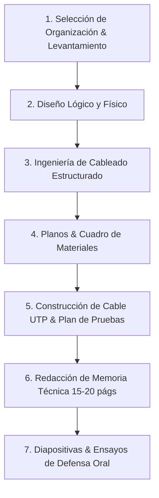

# Análisis Exhaustivo de Requerimientos y Especificaciones del Proyecto
**Documento Fuente:** `legacy/U01-REDES I-PRODUCTO-2026-II.pdf`  
**Asignatura:** Redes I (Unidad I)  
**Título Sugerido:** *"Diseño de la infraestructura física y cableado estructurado de una red LAN para una organización"*  
**Fecha de Análisis:** Octubre 2026

---

## 1. Resumen Ejecutivo y Tipo de Informe Solicitado

El proyecto corresponde a una **evaluación sumativa grupal de la Unidad I** en la que el equipo de estudiantes asume el rol de una **consultora de redes y telecomunicaciones**. 

La consultora es contratada para formular una propuesta técnica integral que implemente o renueve la infraestructura de red física y cableado estructurado de una organización real o simulada de complejidad media.

### Productos / Entregables Obligatorios
1. **Memoria Técnica (Informe Escrito):** Documento formal de ingeniería de aproximadamente **15 a 20 páginas** (excluyendo carátula, anexos y planos).
2. **Diseño y Planos de Red:** Planos arquitectónicos/distribución física que detallen áreas, ubicación de rack, puntos de red (rosetas/jacks), puntos de acceso inalámbrico (AP) y canalizaciones/recorridos de cableado.
3. **Muestra Práctica / Cable UTP Funcional:** Fabricación manual de un cable de red de par trenzado funcional siguiendo el estándar **T568A** o **T568B**, el cual debe ser demostrado y testeado.
4. **Exposición Grupal y Defensa:** Presentación de **20 minutos de exposición + 5 minutos de preguntas** con soporte de 10 a 12 diapositivas orientadas a la justificación técnica de decisiones.

---

## 2. Restricciones y Delimitaciones del Proyecto

### 2.1. Alcance y Límites Técnicos (Qué SÍ y qué NO incluye)
* **ENFOQUE EXCLUSIVO EN CAPA FÍSICA Y ENLACE (UNIDAD I):**
  * Fundamentos de redes, topologías, modelos de referencia (OSI y TCP/IP).
  * Características de medios guiados y no guiados (atenuación, ancho de banda, tasa de bits, ruido, diafonía).
  * Cableado estructurado bajo estándares internacionales (TIA/EIA).
  * Distribución espacial, canalizaciones, racks y componentes pasivos.
* **RESTRICCIÓN EXPLÍCITA (EXCLUSIÓN):**
  * **NO se debe configurar direccionamiento IP, subneteo (FLSM/VLSM) ni protocolos de enrutamiento (Routing)**. El documento señala de forma expresa que estos temas pertenecen al proyecto de la **Unidad II**.

### 2.2. Restricciones del Escenario / Organización
* **Tipología de organización:** Debe ser una empresa, clínica, institución educativa, municipalidad, hotel, biblioteca u otra de similar complejidad operativa.
* **Escala de dispositivos:** Debe contemplar **entre 30 y 60 dispositivos finales e intermedios** que requieran conectividad (ej. computadoras de escritorio, laptops, impresoras de red, puntos de acceso Wi-Fi, servidores locales, teléfonos IP, cámaras de videovigilancia, etc.).
* **Distribución física:** El local debe contar con **varias áreas, departamentos o ambientes definidos**.

### 2.3. Restricciones Formato y Metodológicas
* **Modalidad:** Grupal, conformado estrictamente por **5 integrantes**.
* **Extensión de la memoria:** Aproximadamente **15 a 20 páginas** netas de contenido técnico (sin portada, planos ni anexos).
* **Formato de citación:** Normas **APA** para referencias y bibliografía (recomendación explícita de uso de gestor como Zotero o Mendeley).
* **Defensa oral:** Máximo **10 a 12 diapositivas**, enfocadas no en teoría enciclopédica, sino en la **defensa y justificación de decisiones de diseño e ingeniería**.

---

## 3. Estructura Requerida de la Memoria Técnica (17 Secciones)

El documento PDF detalla la siguiente estructura estándar obligatoria para el informe:

| # | Sección | Contenido Específico Esperado |
|---|---|---|
| **1** | **Portada** | Universidad, curso, título del proyecto, nombres completos de los integrantes, nombre del docente y fecha de entrega. |
| **2** | **Introducción** | Contexto del proyecto, justificación de su realización, alcance y relevancia del diseño de la infraestructura de red. |
| **3** | **Descripción de la Organización** | Razón social/giro comercial, organigrama funcional, distribución de áreas operativas, cantidad y perfil de usuarios, dimensiones y características físicas del inmueble. |
| **4** | **Problemática** | Diagnóstico de la situación actual (red inexistente, saturada o deficiente) y cuadro detallado de necesidades de conectividad identificadas. |
| **5** | **Objetivos** | • **Objetivo General:** Diseño y cálculo integral de la infraestructura. • **Objetivos Específicos:** Medibles, técnicos y alineados a las fases del proyecto. |
| **6** | **Requerimientos de Red** | Inventario y consolidado de dispositivos a conectar: PCs, laptops, impresoras, Access Points (AP), servidores, teléfonos VoIP, terminales especiales, cámaras IP. |
| **7** | **Tipo y Topología de Red** | Clasificación por alcance (LAN, PAN, WLAN, etc.), selección y fundamentación de la topología física (e.g. Estrella extendida / Jerárquica) y topología lógica. |
| **8** | **Modelos OSI y TCP/IP** | Comparativa conceptual y aplicación directa al caso de estudio. Desarrollo detallado de un ejemplo real de **encapsulación y desencapsulación de datos** a través de las capas. |
| **9** | **Sistemas y Medios de Comunicación** | Fundamentos físicos aplicados: tipos de señales (analógicas/digitales), ancho de banda del canal, tasa de bits requerida, efectos de atenuación, relación señal/ruido (SNR), diafonía (crosstalk). |
| **10** | **Selección de Medios** | Matriz comparativa entre par trenzado (UTP/FTP/STP), cable coaxial y fibra óptica (monomodo/multimodo). Justificación técnica y económica del medio o combinación de medios seleccionados. |
| **11** | **Cableado Estructurado** | Normativa aplicable (ANSI/TIA-568, TIA-569, TIA-606, TIA-607). Especificación del rack/gabinete de telecomunicaciones, patch panels, organizadores horizontales/verticales, cableado horizontal (longitud máx. 90m + 10m patch cords), tipo de jacks/plugs RJ-45, categoría del cable (ej. Cat 6 / Cat 6A), y asignación del estándar de terminación (**T568A** o **T568B**). |
| **12** | **Diseño Físico (Planos)** | Planos arquitectónicos a escala con simbología normalizada: distribución de ambientes, ubicación exacta de estaciones de trabajo/puntos de red, ubicación de APs (cobertura wireless), cuarto de comunicaciones (rack) y rutas/canaletas de cableado horizontal. |
| **13** | **Materiales y Equipamiento** | Tabla de especificaciones técnicas y listado de materiales (Bill of Materials - BOM): equipos pasivos y activos contemplados, herramientas, accesorios, cantidades estimadas y fichas técnicas resumidas. |
| **14** | **Plan de Pruebas** | Procedimientos de verificación y certificación básica: comprobación de continuidad pin a pin (wiremap), detección de pares cruzados/abiertos/cortocircuitos, verificación de atenuación y certificación de enlace permanente. |
| **15** | **Conclusiones** | Resumen de los principales resultados, decisiones de diseño tomadas y beneficios operativos/técnicos alcanzados para la organización. |
| **16** | **Referencias** | Bibliografía en formato **APA** (libros de redes, normas TIA/ISO/IEEE, hojas de datos técnicos). |
| **17** | **Anexos** | Planos en tamaño ampliado, fichas técnicas de fabricantes (datasheets), memorias de cálculo (longitudes de cable, capacidad de canaletas, consumo eléctrico de rack), fotografías y diagramas complementarios. |

---

## 4. Requerimientos Prácticos y de Exposición

### 4.1. Demostración Práctica del Cable UTP
* **Producto Físico:** Cada equipo debe presentar físicamente un cable de red UTP ponchado por los mismos integrantes.
* **Norma:** Debe aplicar estrictamente la norma **T568A** o **T568B** (según hayan justificado en el informe).
* **Evaluación Individual Aleatoria:** Durante la sesión de sustentación, el docente podrá seleccionar al azar a cualquier integrante para:
  1. Explicar el procedimiento paso a paso del ponchado (pelado, ordenamiento de colores, corte, crimpado).
  2. Sustentar el estándar aplicado.
  3. Demostrar el funcionamiento y verificación del cable utilizando un probador de cables (tester de red) u otro método adecuado.

### 4.2. Dinámica de la Exposición Oral
* **Duración:** 20 minutos de exposición grupal + 5 minutos de ronda de preguntas (**25 minutos en total** por grupo).
* **Participación:** Los **5 integrantes deben exponer**.
* **Enfoque de las diapositivas (10 a 12 diapositivas):**
  * NO leer teoría general.
  * Defender **decisiones de ingeniería**:
    * ¿Cuál era el problema del cliente?
    * ¿Qué requerimientos de conectividad se identificaron?
    * ¿Qué topología se escogió y por qué?
    * ¿Qué medio de transmisión y categoría de cable se seleccionó y por qué?
    * ¿Cómo se diseñó el sistema de cableado y dónde se ubicaron los racks, puntos de acceso y tomas de red?
    * ¿Cómo se validará y certificará que la instalación física funciona correctamente?
* **Pregunta individual obligatoria:** El docente formulará una pregunta aleatoria a cada estudiante sobre cualquier parte del proyecto para garantizar dominio transversal de la solución.

---

## 5. Distribución de Responsabilidades del Equipo (5 Integrantes)

El documento propone el siguiente reparto de roles funcionales (aunque el dominio final debe ser de todo el grupo):

| Integrante | Rol y Áreas de Responsabilidad Principal | Secciones Asociadas |
|---|---|---|
| **Integrante 1** | **Levantamiento y Diagnóstico:** Análisis del perfil de la organización, diagnóstico del problema, inventario/matriz de requerimientos y definición de objetivos. | Sec. 1, 2, 3, 4, 5, 6 |
| **Integrante 2** | **Fundamentos Teóricos y Modelos:** Aplicación de topologías físicas y lógicas, correspondencia con modelos OSI y TCP/IP, y diseño del flujo de encapsulación. | Sec. 7, 8 |
| **Integrante 3** | **Capa Física y Transmisión:** Estudio de magnitudes físicas (ancho de banda, atenuación, ruido, tasa de bits), análisis comparativo de medios y selección técnica fundamentada. | Sec. 9, 10 |
| **Integrante 4** | **Ingeniería de Cableado Estructurado:** Normativas ANSI/TIA, estándares T568A/B, dimensionamiento de rack, patch panels, canalizaciones y subsistemas de cableado. | Sec. 11 |
| **Integrante 5** | **Diseño Espacial, Pruebas y Consolidación:** Elaboración de planos físicos de planta, tabla de materiales (BOM), plan de pruebas de enlace y ensamblaje final de la memoria y anexos. | Sec. 12, 13, 14, 15, 16, 17 |

*Nota del documento:* **El grupo completo es responsable de velar por la coherencia global y solidez de la solución entregada.**

---

## 6. Rúbrica y Criterios de Calificación (Escala Vigesimal - 20 Puntos)

La calificación se desglosa en los siguientes 8 criterios específicos:

| Criterio de Evaluación | Puntaje Máximo | Aspectos Clave a Evaluar |
|---|:---:|---|
| **1. Análisis del problema y requerimientos** | **2 pts** | Claridad en la problemática descrita, pertinencia del caso de estudio y correcta identificación cuantitativa de necesidades (30 a 60 dispositivos). |
| **2. Aplicación de fundamentos, topologías y OSI/TCP-IP** | **2 pts** | Justificación rigurosa de la topología elegida y precisión en la correlación con los modelos OSI y TCP/IP y su encapsulamiento. |
| **3. Selección y justificación de medios físicos** | **2 pts** | Sustento físico y técnico de la elección del medio (cálculo/comparación de ancho de banda, tasa, atenuación, ruido). |
| **4. Diseño de cableado estructurado** | **4 pts** | Rigor normativo (ANSI/TIA), diseño del cuarto de comunicaciones, subsistema horizontal, patch panel, código de colores y accesorios. *(Criterio de mayor peso).* |
| **5. Plano y diseño físico de la red** | **3 pts** | Calidad gráfica y técnica del plano, distribución coherente de puntos de datos, APs, recorrido de canalizaciones y ubicación del MDF/IDF. |
| **6. Plan de pruebas y cable UTP** | **2 pts** | Viabilidad del plan de pruebas y demostración funcional del cable UTP ponchado bajo norma T568A/B. |
| **7. Calidad de la memoria técnica** | **2 pts** | Redacción profesional, cumplimiento de la estructura de 17 secciones, extensión (15-20 págs), formato APA y coherencia general. |
| **8. Exposición y dominio individual** | **3 pts** | Calidad de la presentación, capacidad de síntesis (10-12 slides), defensa de decisiones y solvencia en las preguntas individuales aleatorias. |
| **TOTAL** | **20 pts** | **Nota máxima posible** |

---

## 7. Hoja de Ruta Recomendada para la Ejecución del Proyecto

Para asegurar la máxima calificación según la rúbrica, el flujo de trabajo sugerido es:

### Acciones Críticas Inmediatas:
1. **Definir la Organización:** Elegir una empresa o local representativo que posea planos arquitectónicos básicos o croquis acotados, garantizando un universo de **30 a 60 nodos**.
2. **Delimitar Estándares de Cableado:** Adoptar preferentemente **Cat 6 o Cat 6A** con terminación **T568B** (o T568A debidamente documentada), fundamentando según distancias y requerimientos de tráfico.
3. **Generar Planos Técnicos:** Usar herramientas como AutoCAD, Microsoft Visio, Sweet Home 3D o Dia para representar claramente el recorrido de bandejas/canaletas y puntos de conexión.
4. **Armado y Ensayo del Cable:** Adquirir cable UTP, conectores RJ-45, capuchones y tester de red para ponchar el cable con antelación y entrenar a todos los miembros en la explicación del código de colores y uso del tester.
5. **Preparación para Preguntas:** Realizar simulacros grupales donde cada integrante deba responder sobre capítulos asignados a otros compañeros.
