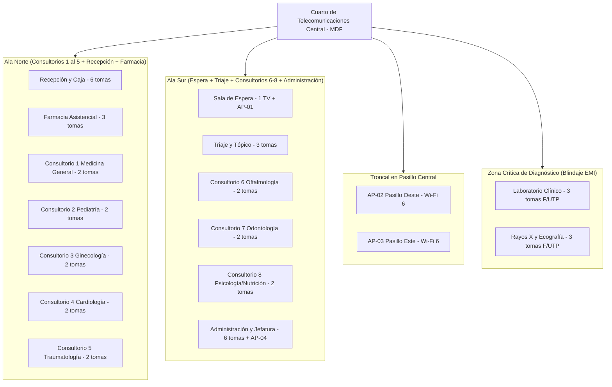
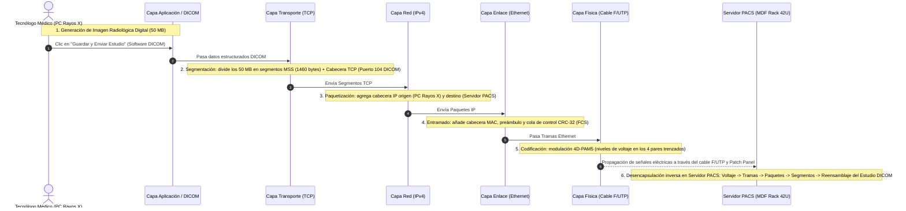
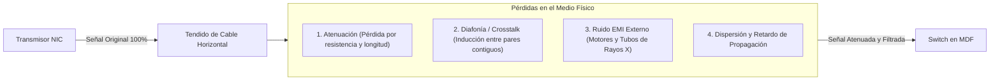
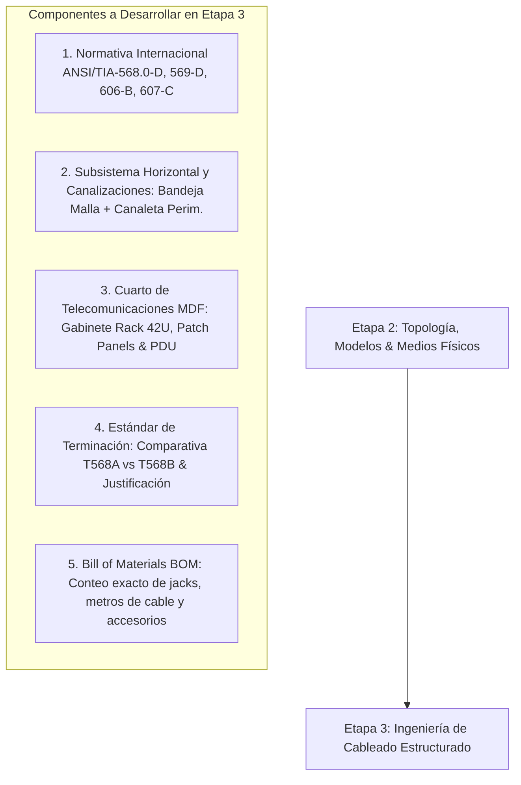

# Etapa 2: Topología, Modelos de Referencia (OSI / TCP-IP) y Selección de Medios de Transmisión
**Proyecto:** Diseño de la Infraestructura Física y Cableado Estructurado de una Red LAN  
**Curso:** Redes I (Unidad I)  
**Organización:** Policlínico de Especialidades Médicas *"Salud & Vida"*  
**Secciones de la Memoria Técnica Cubiertas:** Sección 7, Sección 8, Sección 9 y Sección 10  
**Fecha de Elaboración:** Octubre 2026  

---

## 1. Tipo y Topología de Red (Sección 7)

### 1.1. Clasificación de la Red por su Alcance Geográfico
La infraestructura proyectada para el Policlínico "Salud & Vida" se clasifica como una **Red de Área Local (LAN - Local Area Network)** combinada con un segmento inalámbrico **WLAN (Wireless Local Area Network)**:
* **Cobertura espacial:** Confinada estrictamente dentro del predio del policlínico, con dimensiones de 30 metros de largo por 15 metros de ancho (**450 m²** en una sola planta).
* **Propiedad y administración:** Es una red privada, de administración interna exclusiva de la institución de salud.
* **Tasa de transferencia proyectada:** Conectividad de acceso a **1 Gbps (1000BASE-T)** en puestos de trabajo y hasta **10 Gbps (10GBASE-T)** en enlaces hacia servidores locales y switches de núcleo/distribución.
* **Componente WLAN (IEEE 802.11ax - Wi-Fi 6):** Cuatro Puntos de Acceso (APs) PoE gestionados con **células de cobertura de 8.0 metros de radio efectivo (5 GHz)** con solapamiento controlado del 15% para dar cobertura de alta velocidad médica a tablets y de acceso público en la sala de espera sin cortes (*Fast Roaming*).

### 1.2. Topología Física: Estrella Jerárquica / Estrella Extendida
Se ha seleccionado e implementado una **Topología Física en Estrella Jerárquica** con un único nodo central de consolidación en el **Cuarto de Telecomunicaciones (MDF - Main Distribution Frame)**:

#### Justificación Técnica de la Topología Física en Estrella:
1. **Aislamiento de Fallas:** Si un cable horizontal, jack o terminal de usuario sufre un cortocircuito, aplastamiento o rotura física en un consultorio (por ejemplo, en Consultorio 3), el fallo queda completamente aislado a ese puerto específico sin afectar al resto de la clínica.
2. **Centralización del Mantenimiento:** Toda la conmutación, parcheo, respaldo eléctrico (UPS) y monitoreo se concentran en el Rack 42U del MDF central, facilitando la auditoría y etiquetado bajo la norma **ANSI/TIA-606-B**.
3. **Optimización de Recorridos (Cumplimiento TIA-568):** Al situar el nodo central en el centro de gravedad del edificio, la longitud máxima de cable horizontal permanente hacia la toma más lejana es de **34.8 metros**, muy por debajo de la cota crítica de **90 metros** fijada por estándar internacional.
4. **Escalabilidad Inmediata:** La incorporación de nuevos puntos de red o cámaras de seguridad en el futuro solo requiere tender un cable desde el punto de trabajo hacia el patch panel del MDF, sin reestructurar el tendido de las demás salas.

### 1.3. Topología Lógica: Punto a Punto en Conmutación Ethernet
* **Funcionamiento Lógico:** Aunque los cables convergen físicamente en un solo cuarto de comunicaciones (estrella física), la topología lógica opera mediante **enlaces punto a punto conmutados (Switched Ethernet Full-Duplex - IEEE 802.3ab)**.
* **Eliminación de Colisiones:** Cada estación de trabajo dispone de un canal de transmisión exclusivo bidireccional hacia el puerto del switch del rack. Esto elimina por completo el dominio de colisiones que existía en redes antiguas tipo bus con concentradores (*hubs*), logrando un rendimiento óptimo de 1000 Mbps simétricos sin contienda por el medio.

---

## 2. Aplicación de los Modelos de Referencia OSI y TCP/IP (Sección 8)

### 2.1. Correspondencia de Capas Aplicada al Policlínico "Salud & Vida"

Para este proyecto de infraestructura física, los modelos conceptuales se aterrizan en los dispositivos y componentes reales de la clínica:

| Capa Modelo OSI | Capa Modelo TCP/IP | Componentes Reales en el Policlínico "Salud & Vida" | Función Específica en la Infraestructura |
|---|---|---|---|
| **7. Aplicación** | **Aplicación** | Software EMR (Historia Clínica Electrónica), Visor DICOM para Radiografías, Navegadores Web para facturación electrónica. | Interfaz de software médico con la que interactúan los médicos y enfermeras. |
| **6. Presentación** | **Aplicación** | Formatos estándar médicos: **DICOM** (imágenes radiológicas), **HL7** (mensajería clínica), cifrado SSL/TLS. | Compresión, estandarización y cifrado de los datos médicos sensibles. |
| **5. Sesión** | **Aplicación** | Control de sesiones seguras entre la PC del médico y el servidor local de Historias Clínicas (Keep-Alive, RPC). | Mantiene la sesión de atención del paciente abierta sin pérdida de datos en caso de micro-pausas. |
| **4. Transporte** | **Transporte** | Protocolo **TCP** (para historias clínicas y recetas que requieren entrega 100% garantizada) y **UDP** (para llamadas VoIP y streaming del turnero TV). | Segmentación de datos y asignación de números de puertos de origen y destino. |
| **3. Red** | **Internet** | Direccionamiento lógico y paquetes IP *(Reservado a nivel de configuración para Unidad II)*. | Identificación lógica de los nodos y servidores en el escenario. |
| **2. Enlace de Datos** | **Acceso a la Red** | Tarjetas de Red (NIC) con direcciones MAC en PCs, switches administrables Layer 2 en el Rack, tramas Ethernet (IEEE 802.3). | Detección de errores mediante secuencia de verificación de trama (FCS/CRC-32) y control de acceso al medio MAC. |
| **1. Física** *(Foco Central U1)* | **Acceso a la Red** | **Cable UTP Cat 6, Cable F/UTP Cat 6A blindado, conectores RJ-45, Patch Panels de 24p, Patch Cords, ondas de radio Wi-Fi 6.** | **Conversión de tramas binarias en señales eléctricas de voltaje o pulsos electromagnéticos en los conductores de cobre.** |

---

### 2.2. Ejemplo Real de Encapsulación y Desencapsulación: Envío de un Estudio de Rayos X al Servidor PACS

Para sustentar sólidamente ante el jurado la interacción entre capas, se modela el flujo exacto de datos cuando el Tecnólogo Médico en la sala de Rayos X adquiere una radiografía de tórax y la envía al **Servidor PACS** del Rack central:

#### Detalle Técnico del Encapsulamiento en Transmisión:
1. **Datos de Usuario (Capa 7/6/5):** El estudio radiológico se digitaliza en un archivo compuesto por metadatos (nombre del paciente, fecha, dosis de radiación) y matriz de píxeles sin comprimir en formato DICOM.
2. **Segmento TCP (Capa 4):** La capa de transporte divide el archivo masivo en bloques pequeños acordes al **MSS (Maximum Segment Size = 1460 bytes)** para no sobrecargar el enlace y asigna el puerto de destino estándar de imágenes médicas (**TCP 104 - DICOM Storage**).
3. **Paquete IP (Capa 3):** Se añade la cabecera IP con la dirección de origen y destino, tiempo de vida (TTL) y suma de verificación.
4. **Trama Ethernet (Capa 2):** Se encierra el paquete entre una cabecera Ethernet (dirección MAC de la tarjeta de red de la PC de Rayos X y MAC del switch) y una cola **FCS (Frame Check Sequence de 4 bytes)** que permite al switch detectar si hubo bits alterados por ruido.
5. **Codificación de Señal (Capa 1):** La trama de bits se convierte en niveles discretos de tensión eléctrica mediante el esquema de modulación **4D-PAM5** (Pulse Amplitude Modulation de 5 niveles) transmitido en paralelo a través de los cuatro pares del cable apantallado F/UTP.

---

## 3. Sistemas y Medios de Comunicación (Sección 9)

El diseño de la capa física del policlínico se fundamenta en magnitudes electromagnéticas reales para justificar por qué los cables comerciales no se comportan como simples "cables eléctricos", sino como líneas de transmisión de alta frecuencia.

### 3.1. Señales y Esquema de Codificación
* **Naturaleza de la Señal:** Las señales que circulan por el cableado horizontal son **señales digitales en banda base**.
* **Estándar 1000BASE-T (Gigabit Ethernet):**
  * Emplea los **4 pares de cobre simultáneamente en modo full-duplex bidireccional**.
  * Utiliza modulación **4D-PAM5**, donde cada símbolo transporta 2 bits efectivos de información utilizando 5 niveles discretos de voltaje: **-2V, -1V, 0V, +1V, +2V** (el quinto nivel se utiliza para control de errores y sincronismo FEC).
  * Frecuencia de símbolo: Con una tasa de modulación de 125 MBaudios por par y 2 bits por baudio en 4 pares:  
    $$\text{Tasa Total} = 125\text{ MBaudios} \times 2\text{ bits/baudio} \times 4\text{ pares} = 1000\text{ Mbps (1 Gbps)}$$

### 3.2. Ancho de Banda y Tasa de Transferencia
* **Ancho de Banda Analógico del Canal ($B$ en MHz):**
  * Para **Categoría 6 (UTP):** Certificado hasta **250 MHz**.
  * Para **Categoría 6A (F/UTP):** Certificado hasta **500 MHz**.
* **Tasa de Bits ($R$ en bps):** Es la cantidad neta de datos transmitidos por segundo. En los puestos de trabajo se garantiza una tasa de **1 Gbps (1000 Mbps)** y en la troncal interna del rack **10 Gbps (10GBASE-T)**.
* **Capacidad Máxima de Canal (Teorema de Shannon-Hartley):**
  $$C = B \log_2 \left(1 + \frac{S}{N}\right)$$
  En zonas con alto ruido ambiental ($N$), como Rayos X, si no se utiliza blindaje físico, la relación Señal a Ruido ($SNR = S/N$) decae drásticamente, reduciendo la capacidad teórica del canal y forzando a la tarjeta de red a degradar la velocidad de 1 Gbps a 100 Mbps o provocar retransmisiones.

### 3.3. Fenómenos Físicos de Degradación de Señal en el Policlínico

#### A. Atenuación ($\alpha$ en dB/100m)
* **Definición:** Es la disminución progresiva de la potencia y amplitud de la señal eléctrica a medida que viaja por la longitud del conductor de cobre, causada por la resistencia óhmica del alambre (AWG 23 o AWG 24) y pérdidas dieléctricas en el aislamiento de polietileno.
* **Cálculo aplicado al caso:**
  * En Cat 6 a 250 MHz, la atenuación típica es de aproximadamente **32 dB por cada 100 metros**.
  * Para nuestro punto más distante en el policlínico (**34.8 metros** de canaleta):
    $$\text{Atenuación Estimada} \approx 32\text{ dB} \times \left(\frac{34.8\text{ m}}{100\text{ m}}\right) \approx 11.14\text{ dB}$$
  * Dado que el límite máximo admisible por la norma TIA-568 para el enlace permanente es de **31.1 dB**, nuestro diseño opera con un **margen de seguridad (Headroom) de casi 20 dB**, garantizando señales nítidas sin necesidad de repetidores ni switches intermedios.

#### B. Diafonía (Crosstalk - NEXT / FEXT)
* **Definición:** Acoplamiento electromagnético no deseado entre pares de hilos adyacentes dentro del mismo forro de cable (NEXT = *Near-End Crosstalk*; FEXT = *Far-End Crosstalk*).
* **Solución de diseño en Cat 6:** Los cables Cat 6 incorporan un separador plástico interno en forma de cruz (*spline* cruciforme) que mantiene físicamente separados los cuatro pares trenzados a lo largo de todo el cable, además de tener un paso de torsión (*twist pitch*) diferente y muy ajustado en cada par.

#### C. Interferencia Electromagnética Externa (EMI / RFI)
* **El Problema en el Policlínico:** En la sala de Rayos X (equipo de 100 kV) y Laboratorio (centrífugas y analizadores químicos), la conmutación de corrientes inductivas pesadas genera radiación electromagnética en el rango de radiofrecuencia. Si se empleara cable UTP simple, los hilos actuarían como antenas receptoras, induciendo "ruido de modo común" que falsea los pulsos binarios.
* **Solución Técnica Obligatoria:** En estas dos salas se prescribe cable **F/UTP (Foiled UTP)** con una lámina perimetral de aluminio/poliéster y un hilo de drenaje conectado rígidamente a tierra en el rack (norma **ANSI/TIA-607-C**).

---

## 4. Selección y Justificación de Medios de Transmisión (Sección 10)

Para responder con máxima rigurosidad al informe y la rúbrica, se ha elaborado una **matriz comparativa técnico-económica** de los medios de transmisión físicos del mercado:

### 4.1. Matriz Comparativa de Medios Físicos

| Criterio Técnico | Cable UTP Cat 6 (No apantallado) | Cable F/UTP Cat 6A (Apantallado) | Cable Coaxial (RG-6 / RG-59) | Fibra Óptica Multimodo (OM3 / OM4) | Fibra Óptica Monomodo (OS2) |
|---|:---:|:---:|:---:|:---:|:---:|
| **Ancho de Banda** | 250 MHz | 500 MHz | Hasta 1 GHz | Hasta 4700 MHz·km | Prácticamente ilimitado (THz) |
| **Velocidad Soportada** | 1 Gbps (hasta 10 Gbps <37m) | 10 Gbps (hasta 100m) | < 100 Mbps (Ethernet antiguo) | 10G / 40G / 100 Gbps | 10G a 400 Gbps |
| **Distancia Máxima LAN** | 90 m enlace perm. | 90 m enlace perm. | 185m (10BASE2) / 500m (10BASE5) | 300m - 550m (en 10G) | > 10 km a 40 km |
| **Inmunidad a Ruido EMI** | Media (por par trenzado) | **Muy Alta (Pantalla Al)** | Media-Alta | **Totalmente Inmune** (Luz) | **Totalmente Inmune** (Luz) |
| **Costo por Metro** | Bajo ($0.60 - $0.90 / m) | Moderado ($1.20 - $1.80 / m) | Obsoleto para LAN moderna | Alto ($2.50 - $4.00 / m) | Alto ($3.00 - $5.00 / m) |
| **Costo de Conectores/Equipos** | Muy Bajo (Jacks RJ-45) | Bajo-Moderado (Jacks apantallados) | No compatible con RJ-45 | Muy Alto (Transceptores SFP+) | Muy Alto (Láser DFB + SFP+) |
| **Complejidad de Instalación** | Muy Fácil (Crimpado y ponchado estándar) | Media (Aterrizado obligatorio de pantalla) | Difícil / Rígido | Muy Alta (Fusión por arco y empalmes) | Crítica (Fusión de precisión 9 µm) |
| **Uso en el Policlínico** | **85% de la clínica (Puestos estándar)** | **15% (Rayos X y Laboratorio)** | **Descartado (No aplicable a LAN)** | **Previsto para Uplink Servidores** | **Descartado (Innecesario en 30m)** |

---

### 4.2. Decisiones de Selección Justificadas

#### 1. ¿Por qué se selecciona Cable UTP Categoría 6 LSZH para el 85% de las tomas?
* **Rendimiento Garantizado:** Soporta holgadamente 1000BASE-T (1 Gbps) a 250 MHz. El software de historias clínicas electrónicas, recetas médicas y videollamadas administrativas consumen típicamente menos de 5 a 15 Mbps por usuario, por lo que 1 Gbps por puerto ofrece una capacidad 60 veces superior a la demanda actual.
* **Seguridad Hospitalaria (Forro LSZH - Low Smoke Zero Halogen):** Es mandatorio en centros de salud. En caso de incendio, este forro ignífugo no propaga la llama y no emite gases tóxicos halógenos (cloro/bromo), protegiendo la vida de pacientes que no pueden evacuar rápidamente.
* **Costo-Beneficio Óptimo:** Permite maximizar el presupuesto en el equipamiento central del rack (UPS online, servidores) sin sacrificar calidad en el puesto de trabajo.

#### 2. ¿Por qué se selecciona Cable F/UTP Categoría 6A Apantallado para Rayos X y Laboratorio?
* **Inmunidad ante Ruido Transitorio (EMI):** El apantallamiento de lámina de aluminio evita que los picos electromagnéticos del tubo de Rayos X corrompan las tramas de imágenes DICOM durante la transferencia hacia el servidor PACS.
* **Gran Volumen de Datos:** Los estudios de radiología digital generan archivos de 50 MB a 300 MB por paciente. La categoría 6A garantiza un ancho de banda de 500 MHz y capacidad nativa de 10 Gbps, permitiendo descargar los estudios en menos de 1 segundo en las estaciones de diagnóstico médico.

#### 3. ¿Por qué NO se utiliza Coaxial en la LAN?
* El cable coaxial (10BASE2 "Thinnet" y 10BASE5 "Thicknet") es una tecnología obsoleta desde finales de la década de 1990. Su topología en bus compartida introduce colisiones masivas, no soporta conmutación full-duplex y sus conectores BNC carecen de compatibilidad con las tarjetas de red y switches modernos de Gigabit Ethernet.

#### 4. ¿Por qué NO se utiliza Fibra Óptica en el cableado horizontal pero SÍ como previsión en el Rack?
* **Cableado Horizontal:** La norma ANSI/TIA-568 desaconseja la fibra hasta el escritorio (*Fiber to the Desk - FTTD*) en oficinas estándar de distancias cortas (<40 m) debido al costo desproporcionado de tarjetas de red de fibra y transceptores ópticos para 40 computadoras de escritorio.
* **Enlace Troncal en el Rack:** En el MDF se utiliza un cable DAC (Direct Attach Copper) o latiguillo de fibra óptica multimodo **OM3** de 2 metros para interconectar los dos switches de 24 puertos y los servidores EMR/PACS a **10 Gbps (10GBASE-SR)**, evitando cualquier cuello de botella en el núcleo de la red.

---

## 5. Preparación y Conexión Hacia la Etapa 3 (Cableado Estructurado)

Con la topología, los modelos de referencia y los medios físicos formalmente definidos y justificados, la **Etapa 3** abordará la ingeniería detallada de los subsistemas de cableado estructurado:

### Elementos Clave que se transferirán a la Etapa 3:
1. **Dimensionamiento del Parcheo:** 49 puntos activos + 7 de reserva = **56 tomas**, lo que define exactamente **dos Patch Panels de 24 puertos Cat 6 (48 puertos) + un Patch Panel blindado de 24 puertos Cat 6A (para las 6 tomas blindadas de Rayos X y Laboratorio)**.
2. **Estándar de Conexión:** Adopción justificada de la norma **T568B** por estandarización industrial y coincidencia con la infraestructura preexistente en la mayoría de periféricos comerciales.
3. **Cálculo de Bobinas de Cable:** Con una distancia promedio de 18.5 metros por punto más bajadas verticales y margen de curvatura del 10%, se requerirán aproximadamente **1,200 metros de cable UTP Cat 6 (4 bobinas de 305m)** y **150 metros de cable F/UTP Cat 6A (1 bobina)**.
