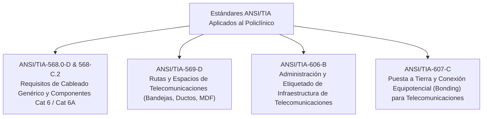
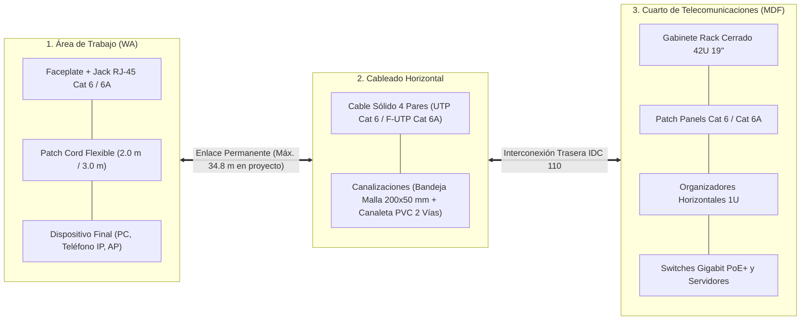
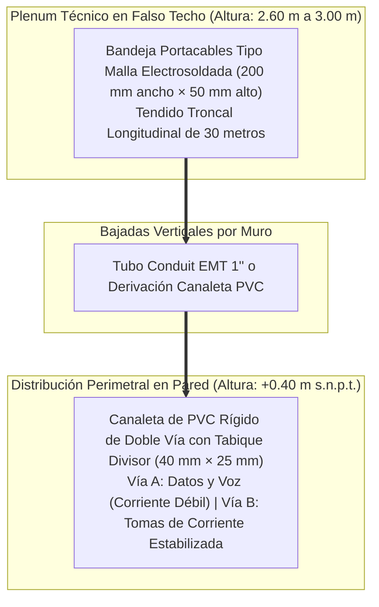
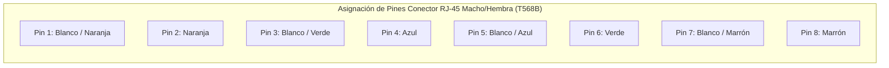
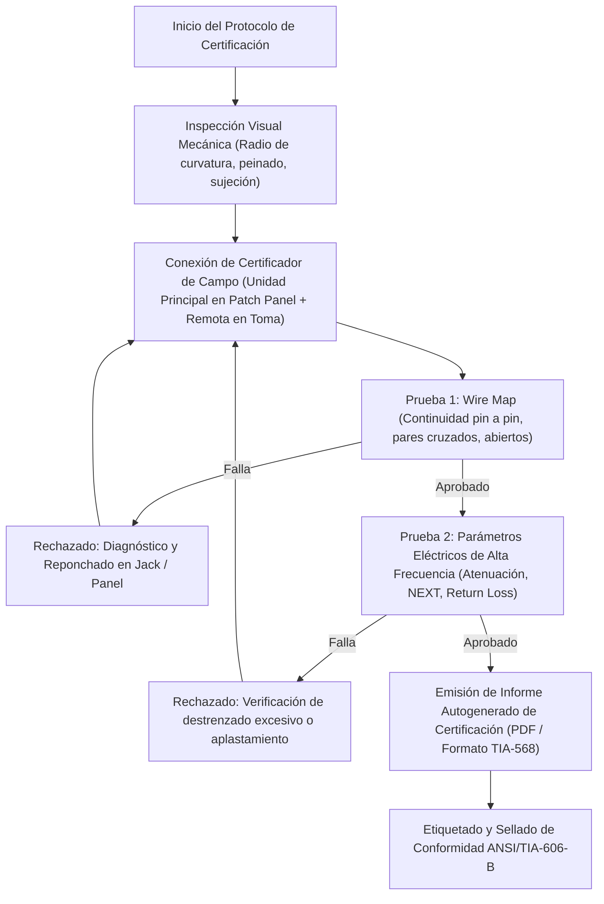
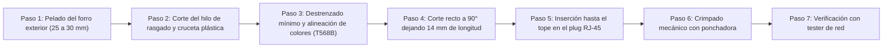
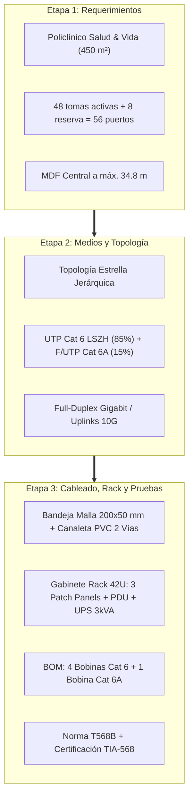

# Etapa 3: Cableado Estructurado, Diseño Físico del Rack, Cómputo de Materiales (BOM) y Plan de Pruebas
**Proyecto:** Diseño de la Infraestructura Física y Cableado Estructurado de una Red LAN  
**Curso:** Redes I (Unidad I)  
**Organización:** Policlínico de Especialidades Médicas *"Salud & Vida"* S.A.C.  
**Secciones de la Memoria Técnica Cubiertas:** Sección 11 (Cableado Estructurado y Normativa), Sección 12 (Diseño Físico y Planos de Red), Sección 13 (Equipos, Materiales y BOM) y Sección 14 (Plan de Pruebas y Certificación)  
**Fecha de Elaboración:** Octubre 2026  

---

## 1. Sección 11: Cableado Estructurado y Marco Normativo

### 1.1. Marco Normativo Internacional Aplicable
El diseño e implementación de la red física del Policlínico "Salud & Vida" se rige estrictamente bajo los estándares unificados de la **Telecommunications Industry Association (TIA)** y el **American National Standards Institute (ANSI)**, adaptados a infraestructuras de misión crítica en entornos de atención médica:

1. **ANSI/TIA-568.0-D (*Generic Telecommunications Cabling for Customer Premises*):**
   * Establece las pautas fundamentales de topología en estrella jerárquica.
   * Fija la distancia máxima del **Enlace Permanente (*Permanent Link*)** en **90 metros**, permitiendo hasta **10 metros combinados para latiguillos (*patch cords*)** (5 m en el rack y 5 m en el área de trabajo), totalizando un canal de transmisión (*Channel*) de máximo **100 metros**.
2. **ANSI/TIA-568-C.2 (*Balanced Twisted-Pair Telecommunications Cabling and Components Standards*):**
   * Define los parámetros eléctricos y de transmisión de par trenzado balanceado de 100 $\Omega$ para **Categoría 6** (hasta 250 MHz) y **Categoría 6A** (hasta 500 MHz), regulando los límites de pérdida de inserción, NEXT, PS-NEXT, Return Loss y retardo de propagación.
3. **ANSI/TIA-569-D (*Telecommunications Pathways and Spaces*):**
   * Regula las dimensiones, accesibilidad y radios de giro para canalizaciones.
   * Especifica que la ocupación inicial de cables en bandejas y canaletas no debe exceder el **40% de llenado transversal**, reservando hasta un 50% para crecimiento futuro.
   * Fija un radio de curvatura mínimo de **4 veces el diámetro exterior (4×OD)** para cable UTP no apantallado y **8×OD** para cable blindado F/UTP durante su instalación.
4. **ANSI/TIA-606-B (*Administration Standard for Commercial Telecommunications Infrastructure*):**
   * Define el esquema alfanumérico para el etiquetado unívoco de cables, tomas de pared, paneles de parcheo, gabinetes y puestas a tierra, asegurando la trazabilidad de cada enlace.
5. **ANSI/TIA-607-C (*Generic Telecommunications Grounding and Bonding for Customer Premises*):**
   * Prescribe la infraestructura de conexión a tierra. Obligatoria para drenar corrientes de fuga y estática generadas por el blindaje de los cables **F/UTP Cat 6A** en Rayos X y Laboratorio, vinculando el chasis del rack central a la **TMGB (*Telecommunications Main Grounding Busbar*)**.

---

### 1.2. Desglose de los Subsistemas de Cableado Estructurado
Al ser una edificación de **un solo nivel (Planta Baja de 450 m²)**, no se requiere un subsistema de cableado troncal vertical (*Backbone* entre pisos). La infraestructura se concentra en tres subsistemas operativos:

* **A. Subsistema de Área de Trabajo (*Work Area - WA*):**
  * Comprende desde la toma de pared (caja adosada/empotrada con *faceplate* de 2 o 4 ventanas y jacks hembra RJ-45 Keystone) hasta el equipo del usuario (computadora, impresora de red, estación DICOM o teléfono VoIP).
  * Se utilizan **patch cords multifilares flexibles Cat 6 / Cat 6A de 2.0 y 3.0 metros**, certificados de fábrica para resistir dobladuras y movimientos diarios.
* **B. Subsistema de Cableado Horizontal:**
  * Transporta las señales desde las tomas de usuario hasta los paneles de conexiones (*patch panels*) dentro del rack del MDF.
  * Emplea cable rígido monofilamento (AWG 23 en Cat 6 y AWG 23 en Cat 6A) con forro ignífugo libre de halógenos **LSZH (*Low Smoke Zero Halogen*)**.
  * No se permiten empalmes intermedios (*splices*) ni derivaciones en puente (*bridge taps*); todos los enlaces son punto a punto directos.
* **C. Subsistema del Cuarto de Telecomunicaciones (*Main Distribution Frame - MDF*):**
  * Espacio físico cerrado de **3.50 m × 4.20 m (14.7 m²)** ubicado en el centro geográfico del inmueble.
  * Aloja el bastidor principal (Rack 42U) que consolida las terminaciones traseras de los cables horizontales en paneles IDC 110, los switches de acceso, los servidores institucionales, la unidad de respaldo ininterrumpido (UPS) y el sistema de tierra de telecomunicaciones.

---

### 1.3. Diseño de Canalizaciones y Rutas Físicas (ANSI/TIA-569-D)

Para aislar interferencias y garantizar la ventilación y peinado del cableado, se implementa una solución mixta de dos niveles:

1. **Troncal Principal en Pasillo Central (Bandeja Tipo Malla):**
   * Se suspende a **2.75 metros** del suelo (dentro del plenum de 40 cm del cielo raso) a lo largo del corredor central de 30 metros.
   * **Dimensiones:** Ancho de **200 mm** y peralte de **50 mm**, fabricada en alambre de acero cincado electrosoldado.
   * **Capacidad de Carga:** El área transversal útil es de $10,000 \text{ mm}^2$. Con un cable Cat 6 estándar de $6.0 \text{ mm}$ de diámetro exterior (área aproximada de $28.3 \text{ mm}^2$ por cable), el mazo troncal más denso de 56 cables ocupa apenas $1,585 \text{ mm}^2$, lo que equivale al **15.8% de ocupación transversal**, situándose ampliamente por debajo del límite conservador del 40% prescrito por la TIA-569-D.
2. **Distribución Secundaria y Perimetral (Canaleta de 2 Vías):**
   * En el interior de cada consultorio y oficina administrativa se utiliza canaleta plástica autoextinguible de **40 mm × 25 mm** fijada a la pared a **+0.40 m** sobre el nivel de piso terminado (o a +1.10 m sobre mesadas de laboratorio).
   * **Separación de Circuitos:** Cuenta con un **tabique divisor interno continuo** que aísla físicamente los cables de red UTP de los cables de fuerza eléctrica de 220 VAC estabilizada, mitigando la inducción de ruido electromagnético de 60 Hz.
3. **Puntos de Techo para Access Points (WLAN):**
   * Cuatro enlaces finalizan directamente en cajas de pase octogonales en el cielo raso a 2.60 m, terminando en jacks hembra y latiguillos de 1.0 m conectados a los APs PoE+ montados en el techo:
     * **AP-01:** Sala de Espera General (red pública/turnero).
     * **AP-02:** Pasillo Central Oeste (cobertura médica consultorios 1 al 4 y triaje).
     * **AP-03:** Pasillo Central Este (cobertura médica consultorios 5 al 8 y laboratorio).
     * **AP-04:** Administración General - extremo este (cobertura administrativa, contable y salas anexas).

---

### 1.4. Estándares de Terminación: T568A vs. T568B y Justificación Técnica

Los estándares **T568A** y **T568B** especifican la correspondencia unívoca entre el código de colores de los 4 pares trenzados y las 8 posiciones de pines del conector modular **RJ-45 (8P8C)**:

| Pin N° | Par TIA | Código de Color T568A | Código de Color T568B (Adoptado) | Función Ethernet (1000BASE-T) |
|:---:|:---:|---|---|:---:|
| **1** | Par 3 / Par 2 | Blanco / Verde | **Blanco / Naranja** | BI_DA+ (Transmisión/Recepción A+) |
| **2** | Par 3 / Par 2 | Verde | **Naranja** | BI_DA- (Transmisión/Recepción A-) |
| **3** | Par 2 / Par 3 | Blanco / Naranja | **Blanco / Verde** | BI_DB+ (Transmisión/Recepción B+) |
| **4** | Par 1 | Azul | **Azul** | BI_DC+ (Transmisión/Recepción C+) |
| **5** | Par 1 | Blanco / Azul | **Blanco / Azul** | BI_DC- (Transmisión/Recepción C-) |
| **6** | Par 2 / Par 3 | Naranja | **Verde** | BI_DB- (Transmisión/Recepción B-) |
| **7** | Par 4 | Blanco / Marrón | **Blanco / Marrón** | BI_DD+ (Transmisión/Recepción D+) |
| **8** | Par 4 | Marrón | **Marrón** | BI_DD- (Transmisión/Recepción D-) |

#### Justificación de la Elección de T568B:
1. **Homogeneidad Industrial:** En el Perú y a nivel comercial en toda Latinoamérica, el esquema **T568B** constituye el estándar de facto predominante en edificios comerciales e instituciones hospitalarias. La totalidad de los patch cords comerciales precintados vienen con terminación T568B.
2. **Compatibilidad con Cableado Preexistente e Interfaces:** Facilita las tareas operativas de soporte técnico, minimizando la probabilidad de que un técnico cometa errores de pinout al reparar un enlace.
3. **Consistencia de Enlace:** Todos los componentes del policlínico (jacks modulares Keystone de pared, patch panels IDC 110 del rack y latiguillos) están ponchados bajo **T568B en ambos extremos**, conformando un **cable directo (*straight-through*)** certificado.

---

## 2. Sección 12: Diseño Físico, Planos y Elevación del Rack 42U

### 2.1. Integración con el Plano Digital Interactivo
El proyecto cuenta con un modelo arquitectónico de alta fidelidad disponible localmente en el visor SVG interactivo (`plano/index.html`), ejecutable en servidor local `http://localhost:3456`:

* **Coordenadas y Escala:** Dimensiones de **30.00 m × 15.00 m (450 m²)** acotadas al centímetro.
* **Geolocalización del MDF:** Ubicado en la coordenada central (**X: 12.50 m a 16.00 m; Y: 0.00 m a 4.20 m**), reduciendo la longitud de la tirada más remota (Consultorio 5 en el extremo oeste y Rayos X en el extremo este) a un valor real de **34.8 metros** de recorrido de canaleta, lo cual otorga un margen de holgura superior al 60% frente a la cota crítica de 90 m de la TIA-568.
* **Trazado de Bandejas:** Muestra en capas vectoriales el recorrido de la bandeja central suspendida, las bajadas a muros y la ubicación precisa de las tomas y de los 4 Puntos de Acceso Wi-Fi 6.

---

### 2.2. Diagrama de Elevación Frontal del Gabinete Rack 42U (MDF)

Se implementa un **Gabinete de Telecomunicaciones cerrado de 42 Unidades de Rack (42U)**, con estándar de 19 pulgadas y 800 mm de profundidad, puerta frontal de vidrio templado con cerradura y paneles laterales desmontables. Su distribución vertical prioriza la separación térmica y la ergonomía de parcheo:

```mermaid
graph TD
    subgraph Rack42U["Gabinete Rack Principal 42U - MDF Central (Vista Frontal)"]
        direction TB
        U42["U41 - U42: Unidad de Ventilación y Extractores de Techo (4 Ventiladores)"]
        U40["U40: Espacio Libre / Reserva de Expansión"]
        U39["U39: Patch Panel 01 (24 Puertos Cat 6 UTP - Puestos 01 al 24)"]
        U38["U38: Organizador Horizontal de Cables 1U (Doble Anillo)"]
        U37["U37: Switch de Acceso 01 (24 Puertos Gigabit PoE+ Layer 2)"]
        U36["U36: Espacio Libre de Ventilación 1U"]
        U35["U35: Patch Panel 02 (24 Puertos Cat 6 UTP - Puestos 25 al 48)"]
        U34["U34: Organizador Horizontal de Cables 1U (Doble Anillo)"]
        U33["U33: Switch de Acceso 02 (24 Puertos Gigabit PoE+ Layer 2)"]
        U32["U32: Espacio Libre de Ventilación 1U"]
        U31["U31: Patch Panel 03 Blindado (24 Puertos Cat 6A F/UTP - Puestos 49 al 56 + Reservas)"]
        U30["U30: Organizador Horizontal de Cables 1U (Doble Anillo)"]
        U29["U29: Switch de Distribución / Core Local (24 Puertos GbE + 4 SFP+ 10G)"]
        U28["U28: Barra de Aterrizaje para Blindaje F/UTP (TIA-607-C)"]
        U27["U25 - U27: Servidor 01 (Historias Clínicas Electrónicas - HCE / Base de Datos) 2U"]
        U24["U23 - U24: Servidor 02 (PACS / Archivo Digital de Imágenes Médicas) 2U"]
        U22["U21 - U22: Servidor NAS (Almacenamiento de Respaldo y Copias de Seguridad) 2U"]
        U20["U19 - U20: Bandeja Deslizante para Monitor KVM / Teclado de Servicio 1U"]
        U18["U11 - U18: Espacio Libre para Expansión de Servidores Futuros (8U)"]
        U10["U09 - U10: Sistema PDU Horizontal con Supresor de Transientes (8 Tomas C13)"]
        U08["U04 - U08: Sistema UPS Online Doble Conversión 3 kVA / 2700W (Montaje en Rack 3U)"]
        U03["U01 - U03: Banco de Baterías Externas Extendidas para UPS (3U - Autonomía 45 min)"]
    end
```

---

### 2.3. Mapa Integral de Asignación de Puertos y Parcheo (56 Puertos)

De acuerdo con la norma **ANSI/TIA-606-B**, cada enlace permanente se codifica unívocamente siguiendo la sintaxis:  
$$\mathbf{[Gabinete]-[PatchPanel]-[Puerto]} \longrightarrow \mathbf{[Código\_Ambiente]-[Toma]}$$

A continuación se detalla la matriz completa de los **56 puertos proyectados** (48 tomas UTP estándar, 6 tomas apantalladas y reservas técnicas):

#### Patch Panel 01: 24 Puertos Cat 6 UTP (U39) — Ala Norte y Accesos
| Puerto Patch | Código Etiqueta TIA-606 | Ambiente Destino | Tipo de Dispositivo Conectado | Medio Físico |
|:---:|---|---|---|:---:|
| **PP01-01** | `R1-PP1-P01 / ADM-D1` | Recepción y Admisión | PC de Admisión 01 | UTP Cat 6 LSZH |
| **PP01-02** | `R1-PP1-P02 / ADM-D2` | Recepción y Admisión | PC de Admisión 02 | UTP Cat 6 LSZH |
| **PP01-03** | `R1-PP1-P03 / CAJ-D1` | Caja Central | PC de Caja 01 | UTP Cat 6 LSZH |
| **PP01-04** | `R1-PP1-P04 / REC-PRN` | Admisión / Caja | Impresora Láser Compartida | UTP Cat 6 LSZH |
| **PP01-05** | `R1-PP1-P05 / ADM-VOIP1` | Recepción | Teléfono IP (VoIP) 01 | UTP Cat 6 LSZH |
| **PP01-06** | `R1-PP1-P06 / CAJ-VOIP2` | Caja | Teléfono IP (VoIP) 02 | UTP Cat 6 LSZH |
| **PP01-07** | `R1-PP1-P07 / ESP-TV` | Sala de Espera General | Smart TV (Turnos Digitales) | UTP Cat 6 LSZH |
| **PP01-08** | `R1-PP1-P08 / AP-01` | Sala de Espera General | Access Point Wi-Fi 6 PoE+ | UTP Cat 6 LSZH |
| **PP01-09** | `R1-PP1-P09 / TRI-D1` | Triaje y Tópico | PC de Registro 01 | UTP Cat 6 LSZH |
| **PP01-10** | `R1-PP1-P10 / TRI-D2` | Triaje y Tópico | PC de Registro 02 | UTP Cat 6 LSZH |
| **PP01-11** | `R1-PP1-P11 / TRI-VOIP` | Triaje y Tópico | Teléfono IP (VoIP) | UTP Cat 6 LSZH |
| **PP01-12** | `R1-PP1-P12 / FAR-D1` | Farmacia | Terminal de Venta 01 | UTP Cat 6 LSZH |
| **PP01-13** | `R1-PP1-P13 / FAR-D2` | Farmacia | Terminal de Venta 02 | UTP Cat 6 LSZH |
| **PP01-14** | `R1-PP1-P14 / FAR-PRN` | Farmacia | Impresora Térmica de Tickets | UTP Cat 6 LSZH |
| **PP01-15** | `R1-PP1-P15 / C01-D1` | Consultorio 01 | PC Médica Consultorio 01 | UTP Cat 6 LSZH |
| **PP01-16** | `R1-PP1-P16 / C01-VOIP`| Consultorio 01 | Teléfono IP / Toma Auxiliar | UTP Cat 6 LSZH |
| **PP01-17** | `R1-PP1-P17 / C02-D1` | Consultorio 02 | PC Médica Consultorio 02 | UTP Cat 6 LSZH |
| **PP01-18** | `R1-PP1-P18 / C02-VOIP`| Consultorio 02 | Teléfono IP / Toma Auxiliar | UTP Cat 6 LSZH |
| **PP01-19** | `R1-PP1-P19 / C03-D1` | Consultorio 03 | PC Médica Consultorio 03 | UTP Cat 6 LSZH |
| **PP01-20** | `R1-PP1-P20 / C03-VOIP`| Consultorio 03 | Teléfono IP / Toma Auxiliar | UTP Cat 6 LSZH |
| **PP01-21** | `R1-PP1-P21 / C04-D1` | Consultorio 04 | PC Médica Consultorio 04 | UTP Cat 6 LSZH |
| **PP01-22** | `R1-PP1-P22 / C04-VOIP`| Consultorio 04 | Teléfono IP / Toma Auxiliar | UTP Cat 6 LSZH |
| **PP01-23** | `R1-PP1-P23 / C05-D1` | Consultorio 05 | PC Médica Consultorio 05 | UTP Cat 6 LSZH |
| **PP01-24** | `R1-PP1-P24 / C05-VOIP`| Consultorio 05 | Teléfono IP / Toma Auxiliar | UTP Cat 6 LSZH |

#### Patch Panel 02: 24 Puertos Cat 6 UTP (U35) — Ala Sur, Administración y APs
| Puerto Patch | Código Etiqueta TIA-606 | Ambiente Destino | Tipo de Dispositivo Conectado | Medio Físico |
|:---:|---|---|---|:---:|
| **PP02-01** | `R1-PP2-P01 / C06-D1` | Consultorio 06 | PC Médica Consultorio 06 | UTP Cat 6 LSZH |
| **PP02-02** | `R1-PP2-P02 / C06-VOIP`| Consultorio 06 | Teléfono IP / Toma Auxiliar | UTP Cat 6 LSZH |
| **PP02-03** | `R1-PP2-P03 / C07-D1` | Consultorio 07 | PC Médica Consultorio 07 | UTP Cat 6 LSZH |
| **PP02-04** | `R1-PP2-P04 / C07-VOIP`| Consultorio 07 | Teléfono IP / Toma Auxiliar | UTP Cat 6 LSZH |
| **PP02-05** | `R1-PP2-P05 / C08-D1` | Consultorio 08 | PC Médica Consultorio 08 | UTP Cat 6 LSZH |
| **PP02-06** | `R1-PP2-P06 / C08-VOIP`| Consultorio 08 | Teléfono IP / Toma Auxiliar | UTP Cat 6 LSZH |
| **PP02-07** | `R1-PP2-P07 / ADM-D1` | Administración General | Puesto Administrativo 01 | UTP Cat 6 LSZH |
| **PP02-08** | `R1-PP2-P08 / ADM-D2` | Administración General | Puesto Administrativo 02 | UTP Cat 6 LSZH |
| **PP02-09** | `R1-PP2-P09 / ADM-D3` | Administración General | Puesto Administrativo 03 | UTP Cat 6 LSZH |
| **PP02-10** | `R1-PP2-P10 / ADM-D4` | Dirección Médica | Puesto Dirección 04 | UTP Cat 6 LSZH |
| **PP02-11** | `R1-PP2-P11 / ADM-PRN` | Administración General | Impresora Multifuncional de Red | UTP Cat 6 LSZH |
| **PP02-12** | `R1-PP2-P12 / ADM-VOIP`| Administración General | Teléfono IP de Jefatura | UTP Cat 6 LSZH |
| **PP02-13** | `R1-PP2-P13 / ADM-AP04`| Administración General | Access Point Wi-Fi 6 PoE+ (AP-04) | UTP Cat 6 LSZH |
| **PP02-14** | `R1-PP2-P14 / PAS-AP02`| Pasillo Central Oeste | Access Point Wi-Fi 6 PoE+ (AP-02) | UTP Cat 6 LSZH |
| **PP02-15** | `R1-PP2-P15 / PAS-AP03`| Pasillo Central Este | Access Point Wi-Fi 6 PoE+ (AP-03) | UTP Cat 6 LSZH |
| **PP02-16** | `R1-PP2-P16 / RES-C01` | Consultorio 01 | Toma de Reserva / Expansión | UTP Cat 6 LSZH |
| **PP02-17** | `R1-PP2-P17 / RES-C02` | Consultorio 02 | Toma de Reserva / Expansión | UTP Cat 6 LSZH |
| **PP02-18** | `R1-PP2-P18 / RES-C03` | Consultorio 03 | Toma de Reserva / Expansión | UTP Cat 6 LSZH |
| **PP02-19** | `R1-PP2-P19 / RES-C04` | Consultorio 04 | Toma de Reserva / Expansión | UTP Cat 6 LSZH |
| **PP02-20** | `R1-PP2-P20 / RES-C05` | Consultorio 05 | Toma de Reserva / Expansión | UTP Cat 6 LSZH |
| **PP02-21** | `R1-PP2-P21 / RES-ADM` | Administración | Toma de Reserva / Expansión | UTP Cat 6 LSZH |
| **PP02-22** | `R1-PP2-P22 / RES-REC` | Recepción | Toma de Reserva / Expansión | UTP Cat 6 LSZH |
| **PP02-23** | `R1-PP2-P23 / RES-FAR` | Farmacia | Toma de Reserva / Expansión | UTP Cat 6 LSZH |
| **PP02-24** | `R1-PP2-P24 / RES-GEN` | Rack MDF | Reserva Técnica Libre de Panel | UTP Cat 6 LSZH |

#### Patch Panel 03: 24 Puertos Cat 6A F/UTP Apantallado (U31) — Rayos X, Laboratorio y Servidores
| Puerto Patch | Código Etiqueta TIA-606 | Ambiente Destino | Tipo de Dispositivo Conectado | Medio Físico |
|:---:|---|---|---|:---:|
| **PP03-01** | `R1-PP3-P01 / RX-DICOM1`| Rayos X y Ecografía | Estación Adquisición DICOM 01 | **F/UTP Cat 6A Blindado** |
| **PP03-02** | `R1-PP3-P02 / RX-DICOM2`| Rayos X y Ecografía | Estación Adquisición DICOM 02 | **F/UTP Cat 6A Blindado** |
| **PP03-03** | `R1-PP3-P03 / RX-PRN` | Rayos X y Ecografía | Impresora Radiológica de Placas | **F/UTP Cat 6A Blindado** |
| **PP03-04** | `R1-PP3-P04 / LAB-D1` | Laboratorio Clínico | Estación Analista Clínico 01 | **F/UTP Cat 6A Blindado** |
| **PP03-05** | `R1-PP3-P05 / LAB-D2` | Laboratorio Clínico | Estación Analista Clínico 02 | **F/UTP Cat 6A Blindado** |
| **PP03-06** | `R1-PP3-P06 / LAB-BIOQ`| Laboratorio Clínico | Analizador Bioquímico Automatizado | **F/UTP Cat 6A Blindado** |
| **PP03-07** | `R1-PP3-P07 / SRV-HCE` | Rack MDF (Servidor) | Enlace Servidor Principal HCE | **F/UTP Cat 6A Blindado** |
| **PP03-08** | `R1-PP3-P08 / SRV-PACS`| Rack MDF (Servidor) | Enlace Servidor Imágenes PACS | **F/UTP Cat 6A Blindado** |
| **PP03-09** | `R1-PP3-P09 / SRV-NAS` | Rack MDF (Storage) | Enlace Almacenamiento Backup | **F/UTP Cat 6A Blindado** |
| **PP03-10 a 24** | `R1-PP3-P[10-24] / RES`| Rack MDF | Puertos Libres de Reserva Blindada | Disponible (15 Puertos) |

---

## 3. Sección 13: Equipos, Materiales y Cómputo Métrico (BOM)

### 3.1. Memoria de Cálculo y Metrado de Cable de Cobre

Para determinar con rigurosidad de ingeniería la cantidad de cable necesaria, se aplica la metodología de cálculo estandarizada:

$$\text{Longitud por Enlace} = \left(\text{Distancia Horizontal por Bandeja/Canaleta} + \text{Bajada Vertical Techo a Pared} + \text{Bajada Vertical Rack}\right) \times 1.10$$

* **Margen de Curvatura y Desperdicio:** Se añade un factor de seguridad del **10% ($\times 1.10$)** para contemplar senos de dilatación, radios de curvatura en esquinas y remates de conectorización.
* **Bajadas Verticales:**
  * En el puesto de trabajo: $2.60\text{ m (cielo raso)} - 0.40\text{ m (toma)} = 2.20\text{ metros}$.
  * En el MDF: bajada desde la bandeja superior hasta la base de parcheo del rack $= 2.00\text{ metros}$.
  * Total fijo por enlace $= 4.20\text{ metros}$.

#### A. Cálculo de Cable UTP Categoría 6 (50 Puntos proyectados: 39 activos horizontales + 8 reservas + 3 puntos de margen técnico)
* **Puntos a cablear:** 39 tomas horizontales activas en áreas de trabajo y pasillos (6 Admisión + 2 Espera + 3 Triaje + 3 Farmacia + 10 Consultorios 1-5 + 6 Consultorios 6-8 + 7 Administración + 2 APs Pasillo) + 8 reservas técnicas + 3 enlaces de contingencia/holgura = 50 puntos de tendido horizontal. *(Nota: los 3 servidores del MDF se conectan internamente en el rack con patch cords directos, y las 6 tomas de Rayos X y Laboratorio utilizan cable F/UTP Cat 6A).*
* **Distancia horizontal promedio:** Calculada a partir de los recorridos en el plano arquitectónico $= 16.50\text{ metros}$.
* **Longitud promedio bruta por punto:** $16.50\text{ m} + 4.20\text{ m (bajadas)} = 20.70\text{ metros}$.
* **Longitud con factor de curvatura (10%):** $20.70\text{ m} \times 1.10 = 22.77\text{ metros por punto}$.
* **Metrado total requerido:**
  $$\text{Metros UTP Cat 6} = 50\text{ puntos} \times 22.77\text{ m/punto} = 1,138.50\text{ metros}$$
* **Cálculo de Bobinas Comerciales (Rollos de 305 m / 1000 ft):**
  $$\text{Cantidad de Bobinas} = \frac{1,138.50\text{ m}}{305\text{ m}} = 3.73 \longrightarrow \mathbf{4\text{ Bobinas de 305 m (1,220 metros totales)}}$$
  *(Queda un remanente operativo de $81.5\text{ metros}$ para reparaciones y sustitución).*

#### B. Cálculo de Cable F/UTP Categoría 6A Blindado (6 Puntos en Rayos X y Laboratorio)
* **Distancia horizontal promedio:** Rayos X y Laboratorio se sitúan en el bloque este, a una distancia de bandeja de $18.00\text{ metros}$ desde el MDF.
* **Longitud promedio por punto:** $(18.00\text{ m} + 4.20\text{ m}) \times 1.10 = 24.42\text{ metros por punto}$.
* **Metrado total requerido:**
  $$\text{Metros F/UTP Cat 6A} = 6\text{ puntos} \times 24.42\text{ m/punto} = 146.52\text{ metros}$$
* **Cálculo de Bobinas Comerciales:**
  $$\text{Cantidad de Bobinas} = \frac{146.52\text{ m}}{305\text{ m}} = 0.48 \longrightarrow \mathbf{1\text{ Bobina de 305 m (305 metros totales)}}$$

---

### 3.2. Bill of Materials (BOM) — Lista Consolidada de Materiales y Equipos

| Ítem | Categoría | Descripción Técnica Detallada | Cantidad | Unidad | Justificación Técnica |
|:---:|---|---|:---:|:---:|---|
| **01** | Cableado Cobre | Bobina de Cable UTP Cat 6 sólido 4 pares AWG 23, forro LSZH ignífugo, 250 MHz, caja 305 m | 4 | Rollo / Caja | Enlaces horizontales estándar en áreas médicas y administrativas (1,220 m en total). |
| **02** | Cableado Cobre | Bobina de Cable F/UTP Cat 6A apantallado con lámina Al/Mylar y conductor de drenaje, AWG 23, LSZH, 500 MHz, caja 305 m | 1 | Rollo / Caja | Enlaces en zonas de alta interferencia electromagnética (Rayos X y Laboratorio). |
| **03** | Conectividad | Jack Modular Hembra RJ-45 Keystone Categoría 6, crimpado 110/Krone con código T568A/B | 50 | Unidad | Tomas de pared en áreas estándar y reservas técnicas. |
| **04** | Conectividad | Jack Modular Hembra RJ-45 Keystone Categoría 6A apantallado metálico (Die-Cast Blindado) | 6 | Unidad | Conectores blindados para salas con equipos médicos inductivos. |
| **05** | Placas de Pared | Faceplate termoplástico de 2 ventanas con etiqueta de identificación transparente | 23 | Unidad | Placas dobles para consultorios, cajas y oficinas. |
| **06** | Placas de Pared | Faceplate termoplástico de 4 ventanas con etiqueta de identificación | 2 | Unidad | Placas cuádruples para el área de Administración y Admisión. |
| **07** | Latiguillos | Patch Cord UTP Cat 6 LSZH de 2.0 m con bota protectora moldeada, terminales T568B | 46 | Unidad | Conexión entre la toma de pared y los puestos de trabajo. |
| **08** | Latiguillos | Patch Cord UTP Cat 6 LSZH de 1.0 m para interconexión dentro de rack | 50 | Unidad | Interconexión entre los Patch Panels y los Switches de acceso en MDF. |
| **09** | Latiguillos | Patch Cord F/UTP Cat 6A Blindado de 2.0 m con conectores blindados metálicos | 6 | Unidad | Latiguillos para estaciones DICOM y analizadores bioquímicos. |
| **10** | Latiguillos | Patch Cord F/UTP Cat 6A Blindado de 1.0 m para rack | 6 | Unidad | Interconexión entre Patch Panel blindado y switch. |
| **11** | Parcheo | Patch Panel de 24 puertos Cat 6 UTP, formato 19'' 1U, terminales traseros IDC 110 | 2 | Unidad | Parcheo de las 48 tomas UTP convencionales (U39 y U35). |
| **12** | Parcheo | Patch Panel de 24 puertos Cat 6A Blindado con barra de soporte y conexión a tierra, 1U | 1 | Unidad | Parcheo de enlaces blindados y servidores (U31). |
| **13** | Organización | Organizador Horizontal de cables con ducto ranurado y tapa plástica, formato 19'' 1U | 3 | Unidad | Enrutamiento ordenado de patch cords en el frontal del rack. |
| **14** | Gabinete | Gabinete Rack cerrado de 42U × 19'', profundidad 800 mm, puerta de vidrio con llave | 1 | Unidad | Contención física, seguridad y climatización del equipamiento MDF. |
| **15** | PDU | Unidad de Distribución de Energía (PDU) para rack 19'', 8 tomas IEC C13 con interruptor térmico | 1 | Unidad | Alimentación eléctrica centralizada de equipos activos. |
| **16** | Respaldo Eléctrico| UPS Online Doble Conversión de 3000 VA / 2700 W, montaje en rack (3U) con tarjeta SNMP | 1 | Unidad | Suministro ininterrumpido y acondicionamiento eléctrico sin tiempo de transferencia. |
| **17** | Respaldo Eléctrico| Banco de Baterías Externo para UPS (3U) | 1 | Unidad | Extensión de la autonomía de respaldo a 45 minutos continuos. |
| **18** | Canalización | Bandeja portacables tipo malla cincada electrosoldada 200 mm × 50 mm (tramos de 3 m) | 10 | Tramo (30m) | Troncal suspendida en falso techo sobre el pasillo central. |
| **19** | Canalización | Kit de suspensión de bandeja: varillas roscadas 3/8'', tuercas, arandelas y soportes | 12 | Juego | Anclaje estructural de la bandeja al forjado del techo cada 2.5 metros. |
| **20** | Canalización | Canaleta perimetral PVC de dos vías con división interna 40 mm × 25 mm (tramos de 2 m) | 45 | Tramo (90m) | Tendido adosado a muros para datos y electricidad en salas. |
| **21** | Conexión a Tierra| Barra Principal de Tierra para Telecomunicaciones (TMGB) de cobre con aisladores y cable AWG 6 | 1 | Juego | Puesta a tierra y equipotencialidad bajo norma ANSI/TIA-607-C. |
| **22** | Equipos Activos | Switch Administrable Layer 2 con 24 Puertos 10/100/1000Base-T PoE+ y 4 enlaces SFP+ 10G | 2 | Unidad | Conmutación de acceso con PoE+ (802.3at) para alimentar APs y telefonía IP. |
| **23** | Equipos Activos | Switch Core / Distribución con 24 Puertos GbE y 4 puertos SFP+ 10G | 1 | Unidad | Conmutación central de alta velocidad para agregación de tráfico y servidores. |
| **24** | Inalámbrico | Access Point Wi-Fi 6 (802.11ax) dual band PoE, montaje en techo | 4 | Unidad | Cobertura inalámbrica médica y pública de alta velocidad. |

---

## 4. Sección 14: Plan de Pruebas, Certificación y Muestra Física

### 4.1. Flujo de Certificación del Cableado Estructurado
Todo enlace permanente instalado debe someterse a un protocolo riguroso de verificación antes de su recepción técnica definitiva:

---

### 4.2. Parámetros Críticos a Certificar y Valores Límite (ANSI/TIA-568-C.2)

Las pruebas deben efectuarse bajo la configuración de **Enlace Permanente (*Permanent Link*)** mediante un certificador de redes de Clase EA / Nivel IIIe (por ejemplo, *Fluke Networks DSX-5000 / DSX-8000*):

| Parámetro Evaluado | Sigla | Descripción Técnica | Límite Máximo / Requisito Cat 6 (a 250 MHz) | Causa Típica de Falla |
|---|:---:|---|:---:|---|
| **Mapa de Cableado** | *Wire Map* | Verifica la correspondencia pin a pin entre ambos extremos, identificando hilos cortados, cortos o inversión de pares. | **Continuidad 1:1 en los 8 pines + continuidad de pantalla (en Cat 6A)** | Error humano al ordenar colores, corte de hilo al pelar el forro. |
| **Longitud Física** | *Length* | Medición reflectométrica de la distancia del enlace mediante TDR (*Time Domain Reflectometry*). | **$\le 90.0\text{ metros}$** para enlace permanente | Tirada excesiva de cable que supera el estándar. |
| **Pérdida de Inserción (Atenuación)** | *IL* | Pérdida de potencia de la señal eléctrica a lo largo del trayecto debido a la resistencia óhmica. | **$\le 31.1\text{ dB}$** (a 250 MHz) | Longitud excesiva, cable de baja calidad (aleación CCA de aluminio en vez de 100% cobre). |
| **Paradiafonía** | *NEXT* | Medición del acoplamiento inductivo entre pares en el extremo transmisor cercano. | **$\ge 35.3\text{ dB}$** (a mayor valor en dB, mayor aislamiento) | Destrenzado de los pares superior a **13 mm (0.5 pulgadas)** al rematar en el conector. |
| **Suma de Potencia NEXT** | *PS-NEXT* | Impacto combinado de diafonía de tres pares activos sobre el cuarto par. | **$\ge 32.7\text{ dB}$** (a 250 MHz) | Cables aplastados por precintos plásticos excesivamente ajustados. |
| **Pérdida de Retorno** | *Return Loss* | Medición de la energía de señal reflejada hacia el emisor por cambios bruscos de impedancia ($100\ \Omega$). | **$\ge 10.0\text{ dB}$** (a 250 MHz) | Deformación del cable, quiebre físico por no respetar el radio de giro ($4\times\text{OD}$). |
| **Retardo de Propagación y Sesgo** | *Delay / Skew*| Diferencia de tiempo de arribo de la señal eléctrica entre el par más rápido y el más lento. | **$Skew \le 45\text{ ns}$** | Torsión despareja de fábrica en los pares trenzados. |

---

### 4.3. Guía de Fabricación Paso a Paso de la Muestra Física del Cable UTP (T568B)

Como entregable obligatorio del proyecto y requisito para la defensa individual ante el docente, el equipo debe construir manualmente un cable de red de par trenzado funcional:

#### Procedimiento Detallado:
1. **Paso 1: Preparación e Inserción de Capuchones:**
   * Insertar el capuchón protector de goma en el extremo del cable antes de desforrar.
2. **Paso 2: Pelado del Aislamiento Exterior:**
   * Con una herramienta pelacables de par trenzado con tope de profundidad, remover exactamente **25 a 30 mm** de la cubierta exterior de PVC/LSZH, teniendo sumo cuidado de no mellar el aislamiento propio de los 8 conductores de cobre.
3. **Paso 3: Remoción del Separador Cruciforme:**
   * Cortar al ras el hilo de rasgado (*rip cord*) y el alma plástica cruciforme central (*spline*) utilizando un alicate de corte diagonal.
4. **Paso 4: Ordenamiento y Peinado bajo T568B:**
   * Destrenzar los hilos únicamente en la longitud indispensable (la norma prohíbe destrenzar más de **13 mm**).
   * Alisar y ordenar los hilos en el orden estricto de izquierda a derecha (con la pestaña de fijación del conector hacia abajo):
     $$\mathbf{1.\ B/Naranja \ -\ 2.\ Naranja \ -\ 3.\ B/Verde \ -\ 4.\ Azul \ -\ 5.\ B/Azul \ -\ 6.\ Verde \ -\ 7.\ B/Marrón \ -\ 8.\ Marrón}$$
5. **Paso 5: Corte Uniforme:**
   * Sujetando firmemente los hilos peinados en paralelo, recortarlos con la cuchilla del alicate de crimpar con un corte perpendicular perfecto a 90°, dejando una longitud expuesta de **13 mm a 14 mm**.
6. **Paso 6: Inserción en el Conector RJ-45:**
   * Deslizar los cables dentro del conector RJ-45 (macho 8P8C) empujando con firmeza hasta que las 8 puntas de cobre hagan contacto visual contra el plástico frontal transparente.
   * **Requisito Crítico:** La cubierta exterior del cable debe ingresar al menos **6 mm dentro del cuerpo del conector**, quedando aprisionada por la traba plástica posterior para asegurar la resistencia a tracciones mecánicas.
7. **Paso 7: Crimpado Mecánico:**
   * Introducir el conector en la cavidad 8P de la tenaza crimpadora de trinquete (*ratchet*) y presionar hasta completar el ciclo mecánico completo. Las cuchillas de contacto doradas perforarán el aislamiento individual estableciendo el contacto eléctrico por desplazamiento de aislamiento (IDC).
8. **Paso 8: Replicación y Ensayos:**
   * Repetir la operación en el extremo opuesto manteniendo la misma norma **T568B**.
   * Conectar ambos extremos a un **Tester de Continuidad de Red (Master y Remote)**: los LEDs del 1 al 8 deben encenderse en secuencia verde rigurosamente sincrónica ($1\text{ al }8$), confirmando la ausencia de cortes, hilos invertidos o falsos contactos.

---

### 4.4. Instrumental y Herramientas Requeridas para Laboratorio y Defensa

| Herramienta / Equipo | Especificación Técnica | Función en la Construcción y Evaluación |
|---|---|---|
| **Ponchadora / Crimpadora Modular** | Herramienta de crimpado con trinquete de bloqueo para conectores RJ-45 (8P8C) y RJ-11 | Fijación a presión uniforme de los pines dorados del conector sobre los conductores. |
| **Herramienta de Impacto (Punch Down Tool)**| Con cuchilla intercambiable reversible tipo 110/Krone y selector de fuerza de impacto | Terminación de los cables en los jacks modulares Keystone y en los paneles de parcheo del rack. |
| **Pelador de Cable UTP/STP** | Herramienta rotativa con cuchilla ajustable en profundidad | Remoción limpia del forro de cable sin dañar el aislamiento de polietileno de los pares internos. |
| **Alicate de Corte Diagonal** | Cortacables de precisión con tratamiento térmico | Corte plano a 90° de los conductores de cobre y retiro de la cruceta central. |
| **Tester de Red Básico (Continuidad)** | Analizador de mapa de cableado con transmisor y receptor remoto para RJ-45/RJ-11 | Verificación visual inmediata de encendido secuencial de LEDs pin a pin (1 a 8). |
| **Certificador de Cableado de Campo** | Analizador de alta frecuencia (ej. *Fluke DSX-5000 / DSX-8000 CableAnalyzer*) | Medición cuantitativa de parámetros RF de Nivel IIIe (Longitud, Atenuación, NEXT, Return Loss). |

---

## 5. Resumen de Consistencia Global entre Etapas

Con la finalización de esta **Etapa 3**, se deja cerrado el componente de ingeniería de cableado estructurado, computo de materiales y protocolos de certificación, proveyendo todos los insumos necesarios para la consolidación final de la **Memoria Técnica** y la preparación de las **diapositivas de defensa oral**.
