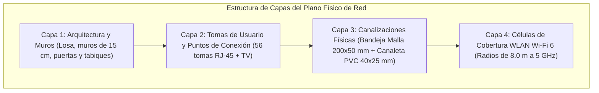
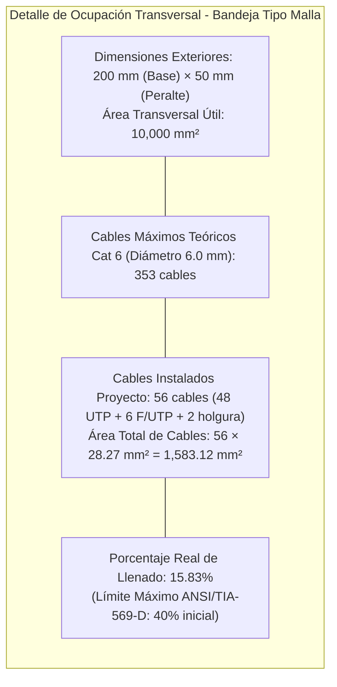
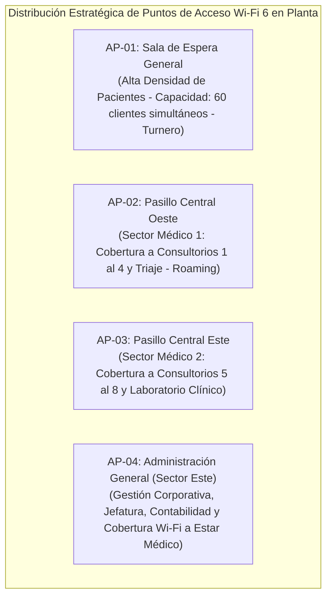
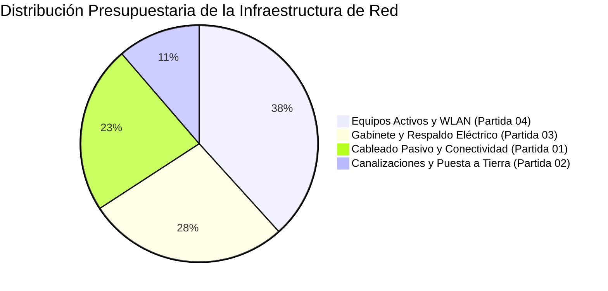
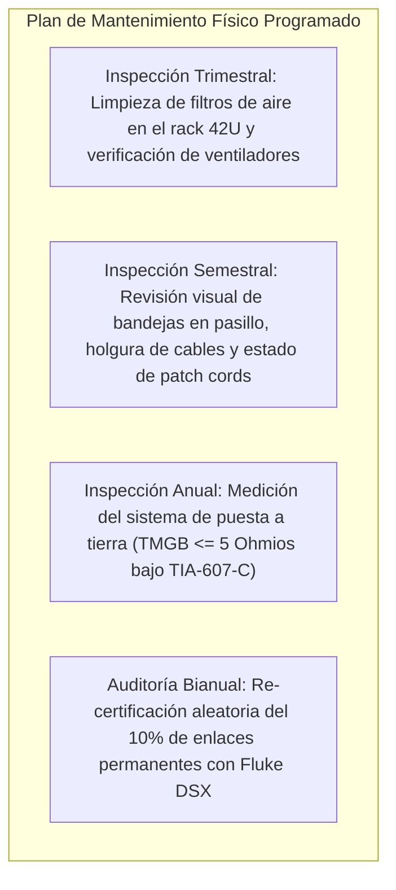

# Etapa 4: Planos de Distribución Física, Rutas de Canalización y Cuadro Consolidado de Materiales (BOM)
**Proyecto:** Diseño de la Infraestructura Física y Cableado Estructurado de una Red LAN  
**Curso:** Redes I (Unidad I)  
**Organización:** Policlínico de Especialidades Médicas *"Salud & Vida"* S.A.C.  
**Secciones de la Memoria Técnica Cubiertas:** Sección 12 (Diseño Físico y Planos de Red) y Sección 13 (Materiales, Equipamiento y Presupuesto Referencial)  
**Fecha de Elaboración:** Octubre 2026  

---

## 1. Introducción y Alcance de la Etapa 4

La presente **Etapa 4** consolida la representación gráfica de ingeniería y la valoración cuantitativa y económica de la infraestructura física del **Policlínico "Salud & Vida"**. 

A partir de los requerimientos identificados en la Etapa 1 (450 m², 1 planta, 48 tomas activas + 8 reservas = 56 enlaces), las decisiones de topología y medios de la Etapa 2 (estrella jerárquica, Cat 6 LSZH y F/UTP Cat 6A), y la arquitectura de subsistemas y terminación T568B de la Etapa 3, este documento establece:

1. **La Simbología Técnica Normalizada** bajo estándares **ANSI/TIA-606-B** y lineamientos internacionales de dibujo de telecomunicaciones (BICSI / IEEE).
2. **El Desglose por Capas Arquitectónicas del Plano Físico**, articulado con el visor digital interactivo SVG (`plano/index.html`).
3. **El Cálculo Métrico de Canalizaciones y Accesorios** (bandeja portacables tipo malla, canaletas de 2 vías y radios de curvatura).
4. **El Estudio de Cobertura Inalámbrica (WLAN Wi-Fi 6)** con diagramas de células de propagación en 5 GHz.
5. **El Presupuesto Económico Referencial (BOM Valorizado)** en moneda nacional (PEN S/.) y dólares americanos (USD $).
6. **Las Fichas Técnicas Resumidas** de los componentes críticos para la carpeta de especificaciones del proyecto.

---

## 2. Sección 12: Simbología Normalizada y Convenciones Gráficas

Para garantizar que los planos arquitectónicos de red sean legibles, estandarizados e interpretables por cualquier cuadrilla de instalación de telecomunicaciones o auditor técnico, se adopta la siguiente tabla de simbología gráfica:

| Símbolo Gráfico | Código TIA-606 | Descripción del Componente | Ubicación Física y Altura |
|:---:|:---:|---|---|
| `[▪ ▪]` | `TO-UTP-2` | Toma doble de pared RJ-45 Keystone Hembra Cat 6 UTP no apantallada | Adosada en pared a **+0.40 m s.n.p.t.** en oficinas y consultorios (+1.10 m en mesadas). |
| `[🛡 🛡]` | `TO-FTP-2` | Toma doble de pared RJ-45 Keystone Hembra Cat 6A F/UTP apantallada metálica | Adosada a **+1.10 m** en Laboratorio Clínico y Rayos X (con conexión a tierra). |
| `(( 📶 ))` | `WLAN-AP` | Punto de Acceso Inalámbrico (Access Point) Wi-Fi 6 Dual Band PoE+ | Anclado en cielo raso a **+2.60 m de altura**, cobertura omnidireccional. |
| `[ 📺 ]` | `TO-IPTV` | Toma de datos RJ-45 para Pantalla Informativa / Smart TV (Turnos) | Montaje mural a **+1.80 m** en Sala de Espera General. |
| `[ 🗄️ 42U ]` | `MDF-R1` | Gabinete Rack cerrado de 42U × 19'' (MDF Principal) | Cuarto de Comunicaciones central, piso técnico, fijado a losa de concreto. |
| `═════════` | `PATH-BM` | Bandeja portacables tipo malla de acero cincado electrosoldada (200×50 mm) | Suspendida en plenum de falso cielo raso a **+2.75 m** a lo largo del pasillo. |
| `─────────` | `PATH-CP` | Canaleta perimetral de PVC rígido de 2 vías con tabique separador (40×25 mm) | Adosada a muros perimetrales en cada ambiente a **+0.40 m s.n.p.t.** |
| `⟂` | `GND-TMGB` | Conexión equipotencial de puesta a tierra de telecomunicaciones | Pletina TMGB en pared del MDF conectada al rack y patch panel blindado. |

---

## 3. Planimetría y Desglose por Capas de Ingeniería

El diseño físico está modelado a escala exacta **1:100 (30.00 m de fondo × 15.00 m de frente = 450.00 m²)** en el sistema interactivo SVG disponible en `http://localhost:3456` (`plano/index.html`). La arquitectura gráfica se descompone en 4 capas superpuestas e independientes:

### 3.1. Cuadro de Coordenadas y Distancias Métricas por Ambiente respecto al MDF

Al estar el **MDF ubicado en la posición central geocéntrica** ($X = 14.00\text{ m},\ Y = 2.10\text{ m}$), los recorridos ortogonales (tipo Manhattan) a través del pasillo y las bajadas a muros quedan estrictamente acotados:

| N° | Ambiente / Sala | Dimensiones (m) | Tomas RJ-45 | Recorrido Horizontal por Bandeja/Canaleta | Bajada Vertical Total (Muro + Rack) | Longitud Real Enlace Permanente | Cumplimiento TIA-568 ($\le 90\text{ m}$) |
|:---:|---|:---:|:---:|:---:|:---:|:---:|:---:|
| **01** | Recepción / Admisión y Caja | 6.0 × 4.2 | 6 (UTP) | 13.80 m | 4.20 m | **18.00 m** | Cumple (80.0% margen) |
| **02** | Sala de Espera General | 7.0 × 7.0 | 2 (1 TV + 1 AP) | 9.50 m | 4.20 m (TV) / 1.50 m (AP) | **13.70 m / 11.00 m** | Cumple (84.7% margen) |
| **03** | Triaje y Tópico | 3.5 × 4.2 | 3 (UTP) | 8.20 m | 4.20 m | **12.40 m** | Cumple (86.2% margen) |
| **04** | Consultorio 01 | 3.5 × 4.2 | 2 (UTP) | 5.50 m | 4.20 m | **9.70 m** | Cumple (89.2% margen) |
| **05** | Consultorio 02 | 3.5 × 4.2 | 2 (UTP) | 9.00 m | 4.20 m | **13.20 m** | Cumple (85.3% margen) |
| **06** | Consultorio 03 | 3.5 × 4.2 | 2 (UTP) | 12.50 m | 4.20 m | **16.70 m** | Cumple (81.4% margen) |
| **07** | Consultorio 04 | 3.5 × 4.2 | 2 (UTP) | 16.00 m | 4.20 m | **20.20 m** | Cumple (77.5% margen) |
| **08** | Consultorio 05 (Extremo Oeste) | 3.5 × 4.2 | 2 (UTP) | 19.50 m | 4.20 m | **23.70 m** | Cumple (73.6% margen) |
| **09** | Consultorio 06 | 3.5 × 4.2 | 2 (UTP) | 6.20 m | 4.20 m | **10.40 m** | Cumple (88.4% margen) |
| **10** | Consultorio 07 | 3.5 × 4.2 | 2 (UTP) | 9.70 m | 4.20 m | **13.90 m** | Cumple (84.5% margen) |
| **11** | Consultorio 08 | 3.5 × 4.2 | 2 (UTP) | 13.20 m | 4.20 m | **17.40 m** | Cumple (80.6% margen) |
| **12** | Rayos X y Ecografía (Zona Crítica) | 5.0 × 4.2 | 3 (F/UTP) | 28.50 m | 4.20 m | **32.70 m** | Cumple (63.6% margen) |
| **13** | Laboratorio Clínico (Zona Crítica) | 4.5 × 4.2 | 3 (F/UTP) | 30.60 m | 4.20 m | **34.80 m** *(Toma más lejana)* | Cumple (61.3% margen) |
| **14** | Farmacia Asistencial | 3.5 × 4.2 | 3 (UTP) | 11.20 m | 4.20 m | **15.40 m** | Cumple (82.8% margen) |
| **15** | Administración, Jefatura y Contabilidad | 3.5 × 7.0 | 7 (6 UTP + 1 AP-04) | 17.80 m | 4.20 m (PCs) / 1.50 m (AP) | **22.00 m / 19.30 m** | Cumple (75.5% margen) |
| **16** | Pasillo Central (Troncal y APs de Techo) | 30.0 × 2.4 | 2 (AP-02 y AP-03 PoE) | 7.00 m / 12.00 m | 1.50 m | **8.50 m / 13.50 m** | Cumple (90.5% margen) |
| **17** | Enlaces Directos en Rack MDF (Servidores) | 3.5 × 4.2 | 3 (Servidores HCE, PACS, NAS) | 1.50 m | 1.00 m | **2.50 m** | Cumple (Directo en Rack) |
| **18** | Tomas de Reserva Técnica (Expansión) | Distribuidas | 8 (UTP Cat 6) | ~18.00 m | 4.20 m | **~22.20 m** | Cumple (Holgura > 15%) |
| **--** | **TOTAL PUNTOS PROYECTADOS** | **450 m²** | **56 Tomas (48 Activas + 8 Reservas)** | -- | -- | **Promedio: 16.5 m** | **100% CUMPLE NORMA** |

---

## 4. Diseño y Cálculo Métrico de Canalizaciones Físicas

### 4.1. Troncal Principal: Bandeja Malla Electrosoldada en Pasillo Central
* **Trayectoria:** Línea recta suspendida de 30 metros longitudinales a lo largo del corredor central de circulación.
* **Sujeción Mecánica:** Suspendida cada **2.50 metros** mediante varillas roscadas de acero de $3/8''$ ancladas al techo con tacos de expansión metálicos.
* **Transición hacia Ambientes:** En cada derivación lateral hacia un consultorio u oficina, se emplea un accesorio de salida suave con radio de curvatura controlado (*curvadores plásticos de salida tipo trompeta*) que previene el estrés de corte o doblado en ángulo vivo del cable.

### 4.2. Distribución Perimetral: Canaleta de PVC de Dos Vías
* **Especificación:** Canaleta plástica de **40 mm × 25 mm** fabricada en PVC rígido autoextinguible (grado UL94 V-0).
* **División Física:** Incorpora un tabique separador hermético en toda su longitud. La **Vía A** (superior) alberga los cables de telecomunicaciones Cat 6 / Cat 6A; la **Vía B** (inferior) transporta el cableado de energía estabilizada de 220 VAC.
* **Accesorios de Continuidad:** Se emplean esquineros interiores, esquineros exteriores, tes de derivación y tapas terminales para evitar empalmes cortantes y garantizar el radio de curvatura mínimo de **$4 \times \text{OD} = 25\text{ mm}$**.

---

## 5. Estudio y Simulación de Cobertura Inalámbrica (WLAN Wi-Fi 6)

Para satisfacer la movilidad de las tablets del personal médico y la conectividad pública de los pacientes, se han ubicado estratégicamente **4 Puntos de Acceso (Access Points - APs) Wi-Fi 6 (IEEE 802.11ax)** alimentados mediante PoE+ (802.3at):

### 5.1. Criterios de Propagación y Radiofrecuencia (Banda de 5 GHz):
* **Radio de Célula Efectivo:** **8.0 metros** de cobertura circular en espacio semiabierto hospitalario.
* **Nivel de Señal en Borde de Célula (Cell Edge RSSI):** $\ge -65\text{ dBm}$, asegurando modulaciones MCS altas y tasas reales superiores a 150 Mbps por usuario.
* **Solapamiento (*Overlap*):** Diseñado con un **15% de traslape entre áreas de cobertura adyacentes**, lo cual garantiza una transición sin corte de llamada (*Fast Roaming 802.11r/k/v*) para el personal asistencial que se desplaza entre salas.
* **Separación de Redes (SSID):**
  * *SSID Médico ("Salud_Clinica"):* Prioridad QoS WMM para voz y datos EMR, cifrado WPA3-Enterprise.
  * *SSID Público ("Salud_Pacientes"):* Aislado de la red interna, con ancho de banda limitado por usuario.

---

## 6. Sección 13: Cuadro Consolidado de Materiales (BOM) y Presupuesto Referencial

A continuación se presenta el **Bill of Materials (BOM) Valorizado**, calculado con base en precios promedio de mercado institucional y distribuidores autorizados de telecomunicaciones en el Perú (Panduit, Siemon, Cisco, APC, Schneider Electric). Se expresa en **Dólares Americanos (USD $)** y su equivalente en **Soles Peruanos (PEN S/.)** a un tipo de cambio referencial de **S/. 3.75**:

### 6.1. Partida 01: Infraestructura Pasiva de Cableado y Conectividad
| Ítem | Código | Descripción del Insumo | Cantidad | Unidad | P. Unitario (USD) | Subtotal (USD) | Subtotal (PEN S/.) |
|:---:|---|---|:---:|:---:|:---:|:---:|:---:|
| 1.1 | `CAB-CAT6` | Bobina de Cable UTP Cat 6 LSZH 23 AWG (305 m), caja dispensadora | 4 | Rollo | $ 195.00 | $ 780.00 | S/. 2,925.00 |
| 1.2 | `CAB-CAT6A`| Bobina de Cable F/UTP Cat 6A Blindado LSZH 23 AWG (305 m), caja | 1 | Rollo | $ 340.00 | $ 340.00 | S/. 1,275.00 |
| 1.3 | `JK-CAT6` | Jack Modular Hembra RJ-45 Keystone Cat 6 UTP (90°/180°) | 50 | Pza | $ 3.80 | $ 190.00 | S/. 712.50 |
| 1.4 | `JK-CAT6A` | Jack Modular Hembra RJ-45 Keystone Cat 6A Blindado Metálico | 6 | Pza | $ 8.50 | $ 51.00 | S/. 191.25 |
| 1.5 | `FP-2V` | Faceplate de pared blanco termoplástico de 2 ventanas con rotulado | 23 | Pza | $ 2.20 | $ 50.60 | S/. 189.75 |
| 1.6 | `FP-4V` | Faceplate de pared blanco termoplástico de 4 ventanas con rotulado | 2 | Pza | $ 3.50 | $ 7.00 | S/. 26.25 |
| 1.7 | `PC-UTP-2M`| Patch Cord UTP Cat 6 LSZH de 2.0 m con bota protectora | 46 | Pza | $ 4.20 | $ 193.20 | S/. 724.50 |
| 1.8 | `PC-UTP-1M`| Patch Cord UTP Cat 6 LSZH de 1.0 m para rack | 50 | Pza | $ 3.10 | $ 155.00 | S/. 581.25 |
| 1.9 | `PC-FTP-2M`| Patch Cord F/UTP Cat 6A Blindado de 2.0 m | 6 | Pza | $ 7.80 | $ 46.80 | S/. 175.50 |
| 1.10| `PC-FTP-1M`| Patch Cord F/UTP Cat 6A Blindado de 1.0 m para rack | 6 | Pza | $ 5.90 | $ 35.40 | S/. 132.75 |
| 1.11| `PP-24-C6` | Patch Panel de 24 puertos Cat 6 UTP formato 19'' 1U con barra trasera | 2 | Pza | $ 85.00 | $ 170.00 | S/. 637.50 |
| 1.12| `PP-24-C6A`| Patch Panel de 24 puertos Cat 6A Blindado descargado con puesta a tierra | 1 | Pza | $ 135.00 | $ 135.00 | S/. 506.25 |
| 1.13| `ORG-1U` | Organizador Horizontal de cables con tapa plástica ranurada 1U 19'' | 3 | Pza | $ 18.00 | $ 54.00 | S/. 202.50 |
| **--** | **SUBTOTAL** | **Partida 01: Infraestructura Pasiva** | | | | **$ 2,208.00** | **S/. 8,280.00** |

### 6.2. Partida 02: Canalizaciones y Puesta a Tierra
| Ítem | Código | Descripción del Insumo | Cantidad | Unidad | P. Unitario (USD) | Subtotal (USD) | Subtotal (PEN S/.) |
|:---:|---|---|:---:|:---:|:---:|:---:|:---:|
| 2.1 | `BM-200X50`| Bandeja portacables tipo malla cincada 200×50 mm (tramos de 3.0 m) | 10 | Tramo | $ 32.00 | $ 320.00 | S/. 1,200.00 |
| 2.2 | `ACC-BM` | Kit de accesorios para bandeja (uniones, pernos, grapas de sujeción) | 1 | Glb | $ 85.00 | $ 85.00 | S/. 318.75 |
| 2.3 | `VAR-3/8` | Varilla roscada 3/8'' con tacos de expansión y tuercas (juego de soporte) | 12 | Juego | $ 6.50 | $ 78.00 | S/. 292.50 |
| 2.4 | `CAN-40X25`| Canaleta PVC de dos vías con división interna 40×25 mm (tramos 2.0 m) | 45 | Tramo | $ 8.40 | $ 378.00 | S/. 1,417.50 |
| 2.5 | `ACC-CAN` | Accesorios de canaleta (esquineros interiores/exteriores, tes y uniones) | 1 | Glb | $ 65.00 | $ 65.00 | S/. 243.75 |
| 2.6 | `GND-TMGB` | Barra Principal de Tierra TMGB de cobre (10×50×300 mm) + aisladores | 1 | Pza | $ 110.00 | $ 110.00 | S/. 412.50 |
| 2.7 | `CAB-GND` | Cable de cobre desnudo/aislado verde AWG 6 para bonding de rack (15 m) | 1 | Rollo | $ 48.00 | $ 48.00 | S/. 180.00 |
| **--** | **SUBTOTAL** | **Partida 02: Canalizaciones y Puesta a Tierra** | | | | **$ 1,084.00** | **S/. 4,065.00** |

### 6.3. Partida 03: Gabinete Rack, Respaldo Eléctrico y Climatización
| Ítem | Código | Descripción del Insumo | Cantidad | Unidad | P. Unitario (USD) | Subtotal (USD) | Subtotal (PEN S/.) |
|:---:|---|---|:---:|:---:|:---:|:---:|:---:|
| 3.1 | `RCK-42U` | Gabinete Rack cerrado de 42U × 19'', profundidad 800 mm, vidrio y llave | 1 | Pza | $ 750.00 | $ 750.00 | S/. 2,812.50 |
| 3.2 | `PDU-8T` | Regleta PDU horizontal 1U para rack con 8 tomas C13 y switch térmico | 1 | Pza | $ 75.00 | $ 75.00 | S/. 281.25 |
| 3.3 | `UPS-3KVA` | UPS Online Doble Conversión 3000 VA / 2700 W montaje en rack (3U) | 1 | Pza | $ 1,150.00 | $ 1,150.00 | S/. 4,312.50 |
| 3.4 | `BAT-EXT` | Banco de baterías extendidas para UPS 3kVA (3U, autonomía 45 min) | 1 | Pza | $ 580.00 | $ 580.00 | S/. 2,175.00 |
| 3.5 | `VENT-4F` | Bandeja superior de 4 extractores de aire de 220 VAC con termostato | 1 | Pza | $ 95.00 | $ 95.00 | S/. 356.25 |
| **--** | **SUBTOTAL** | **Partida 03: Gabinete y Respaldo Eléctrico** | | | | **$ 2,650.00** | **S/. 9,937.50** |

### 6.4. Partida 04: Equipamiento Activo de Red y Conectividad Inalámbrica
| Ítem | Código | Descripción del Insumo | Cantidad | Unidad | P. Unitario (USD) | Subtotal (USD) | Subtotal (PEN S/.) |
|:---:|---|---|:---:|:---:|:---:|:---:|:---:|
| 4.1 | `SW-ACC-POE`| Switch Capa 2 Administrable 24P GbE PoE+ (370W) + 4 Uplinks SFP+ 10G | 2 | Pza | $ 820.00 | $ 1,640.00 | S/. 6,150.00 |
| 4.2 | `SW-CORE` | Switch Capa 2/3 Distribución 24P GbE + 4 Puertos SFP+ 10G para servidores | 1 | Pza | $ 950.00 | $ 950.00 | S/. 3,562.50 |
| 4.3 | `DAC-10G` | Cable DAC (Direct Attach Copper) pasivo SFP+ 10 Gbps de 1.0 m para uplink | 4 | Pza | $ 35.00 | $ 140.00 | S/. 525.00 |
| 4.4 | `AP-WIFI6` | Access Point Empresarial Wi-Fi 6 (802.11ax) Dual Band 2.4/5GHz PoE+ | 4 | Pza | $ 240.00 | $ 960.00 | S/. 3,600.00 |
| **--** | **SUBTOTAL** | **Partida 04: Equipamiento Activo y WLAN** | | | | **$ 3,690.00** | **S/. 13,837.50** |

---

### 6.5. Resumen General del Presupuesto de Infraestructura

| Partida | Descripción del Rubro | Subtotal (USD $) | Subtotal (PEN S/.) | Incidencia (%) |
|:---:|---|:---:|:---:|:---:|
| **Partida 01** | Infraestructura Pasiva de Cableado y Conectividad | $ 2,208.00 | S/. 8,280.00 | 22.92 % |
| **Partida 02** | Canalizaciones Físicas y Puesta a Tierra | $ 1,084.00 | S/. 4,065.00 | 11.25 % |
| **Partida 03** | Gabinete Rack 42U, Respaldo Eléctrico UPS y Climatización | $ 2,650.00 | S/. 9,937.50 | 27.52 % |
| **Partida 04** | Equipamiento Activo de Red y Access Points Wi-Fi 6 | $ 3,690.00 | S/. 13,837.50 | 38.31 % |
| **TOTAL** | **COSTO TOTAL DIRECTO DE SUMINISTROS (BOM)** | **$ 9,632.00** | **S/. 36,120.00** | **100.00 %** |

---

## 7. Fichas Técnicas Resumidas de Componentes Críticos

Para efectos de la Memoria Técnica y auditoría de compras, se presentan los extractos de especificaciones (*Datasheets*) de los 4 componentes más relevantes del proyecto:

### 7.1. Ficha Técnica: Cable UTP Categoría 6 LSZH (Panduit / Siemon)
* **Calibre del Conductor:** 23 AWG de cobre sólido electrolítico al 100% (sin aleaciones de aluminio CCA).
* **Aislamiento Interno:** Polietileno de alta densidad con alma central plástica en cruz (*spline*).
* **Forro Exterior:** Compuesto termoplástico retardante a la llama **LSZH (IEC 60332-1, IEC 60754, IEC 61034)**.
* **Rango de Frecuencia:** Testeado y garantizado hasta **250 MHz** (rendimiento para 1000BASE-T Gigabit Ethernet).
* **Tensión Máxima de Tracción durante Instalación:** $110\text{ N (25 lbf)}$.
* **Radio de Curvatura Mínimo:** $4 \times \text{OD} \approx 25\text{ mm}$ en reposo.

### 7.2. Ficha Técnica: Cable F/UTP Categoría 6A Apantallado (Rayos X y Laboratorio)
* **Calibre del Conductor:** 23 AWG de cobre sólido.
* **Blindaje Global:** Lámina de poliéster/aluminio perimetral (cobertura 100%) con hilo de drenaje estañado continuo.
* **Forro Exterior:** LSZH ignífugo color gris/azul.
* **Ancho de Banda:** Certificado hasta **500 MHz** (soporte nativo de 10GBASE-T hasta 100 metros).
* **Aislamiento Electromagnético:** Eficacia de apantallamiento $\ge 40\text{ dB}$ en el rango de 30 MHz a 1000 MHz, eliminando el ruido de acoplamiento de tubos radiológicos y motores centrífugos.

### 7.3. Ficha Técnica: Gabinete Rack 42U 19'' (Estándar EIA-310-E)
* **Capacidad Útil:** 42 Unidades de Rack (42U) con perfiles milimetrados en ambos lados.
* **Dimensiones Físicas:** Alto: 2,050 mm | Ancho: 600 mm | Profundidad: 800 mm.
* **Estructura:** Acero laminado en frío SPCC de 1.5 mm a 2.0 mm de espesor, acabado en pintura electrostática texturizada negra.
* **Carga Estática Admisible:** Hasta **800 kg**, asegurando soporte pleno para UPS, banco de baterías y servidores.
* **Puertas y Seguridad:** Puerta frontal de cristal templado de 5 mm con cerradura tubular; puerta posterior perforada al 70% para ventilación por convección forzada.

### 7.4. Ficha Técnica: UPS Online Doble Conversión 3 kVA / 2.7 kW (APC Smart-UPS On-Line)
* **Topología:** Doble conversión en línea (*On-Line Double Conversion*) con salida senoidal pura ($\text{THD} < 2\%$).
* **Potencia Nominal:** 3000 VA / 2700 Watts (Factor de potencia 0.9).
* **Tiempo de Transferencia:** **0 milisegundos (Ininterrumpido)**, indispensable para evitar reinicios en servidores EMR/PACS.
* **Rango de Voltaje de Entrada:** 160 VAC a 280 VAC a 60 Hz.
* **Interfaz de Gestión:** Tarjeta de red SNMP integrada con apagado automático ordenado de servidores ante corte prolongado.

---

## 8. Plan de Mantenimiento Preventivo Físico de la Red

Para asegurar una vida útil mínima de **15 a 20 años** del sistema de cableado estructurado según la garantía de los fabricantes, se prescribe el siguiente calendario de inspecciones:

1. **Mantenimiento Trimestral:**
   * Limpieza de polvo acumulado en rejillas y filtros del techo del rack 42U mediante aspiradora antiestática.
   * Monitoreo térmico del MDF (mantener entre $18^\circ\text{C}$ y $24^\circ\text{C}$ con humedad no condensante del 30% al 50%).
2. **Mantenimiento Semestral:**
   * Inspección visual en cielo raso de la bandeja tipo malla para constatar que no existan roedores, humedad ni sobrecarga por cables ajenos no autorizados.
   * Verificación del peinado de patch cords en organizadores frontales de 1U.
3. **Mantenimiento Anual:**
   * Medición con telurómetro del pozo de puesta a tierra de telecomunicaciones, verificando una resistencia de contacto $\le 5\ \Omega$.
   * Apriete de pernos y reapriete del cable de drenaje del Patch Panel blindado Cat 6A.
