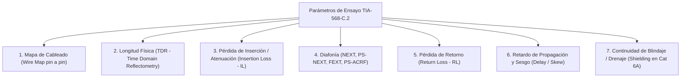
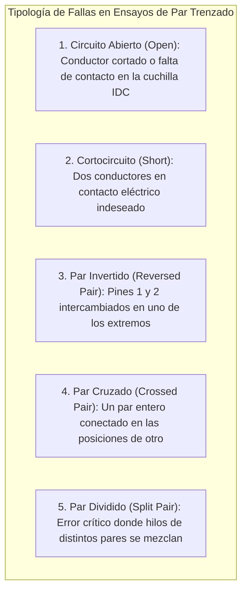
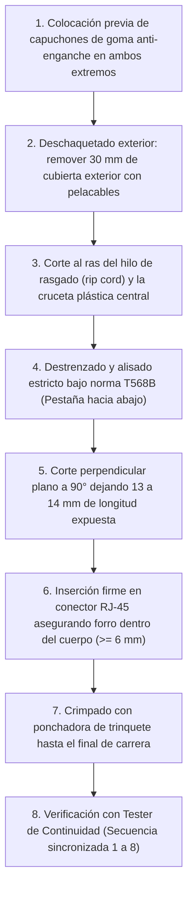
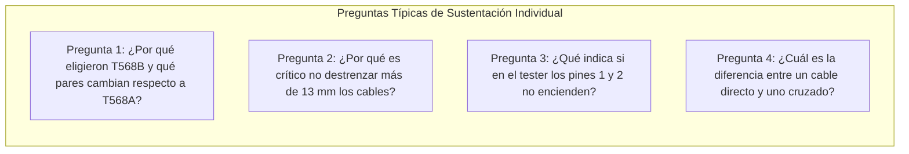
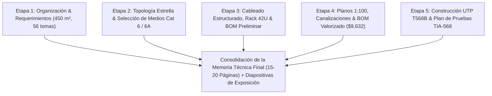

# Etapa 5: Construcción de Cable UTP, Protocolo de Ensayos y Plan de Pruebas de Certificación
**Proyecto:** Diseño de la Infraestructura Física y Cableado Estructurado de una Red LAN  
**Curso:** Redes I (Unidad I)  
**Organización:** Policlínico de Especialidades Médicas *"Salud & Vida"* S.A.C.  
**Secciones de la Memoria Técnica Cubiertas:** Sección 14 (Plan de Pruebas y Certificación de Enlace) y Requerimiento Práctico 4.1 (Muestra Física y Defensa Individual del Cable UTP)  
**Fecha de Elaboración:** Octubre 2026  

---

## 1. Introducción y Objetivos de la Etapa 5

La **Etapa 5** constituye el componente de validación empírica, control de calidad y aseguramiento normativo del proyecto de cableado estructurado del **Policlínico "Salud & Vida"**. 

Mientras que las etapas previas establecieron el diseño teórico, los modelos de referencia, la topología y el dimensionamiento de materiales, esta fase define:
1. **El protocolo metrológico de certificación** de los 56 enlaces permanentes bajo el estándar **ANSI/TIA-568-C.2**.
2. **El procedimiento exhaustivo de manufactura artesanal** de la muestra física de cable de par trenzado UTP Categoría 6 bajo la norma **T568B**.
3. **La taxonomía de fallas de cableado**, explicando el comportamiento físico de cortocircuitos, pares abiertos, inversiones y pares divididos (*split pairs*).
4. **La guía de preparación y guion para la evaluación individual aleatoria**, asegurando que cualquiera de los 5 integrantes del equipo demuestre dominio técnico absoluto del armado y comprobación del medio físico ante el docente.
5. **El formato formal de Hoja de Reporte de Certificación (*Test Report Sheet*)** para su incorporación en la Memoria Técnica final.

---

## 2. Sección 14: Plan de Pruebas y Certificación de Enlace Permanente

### 2.1. Diferenciación Metrológica: Enlace Permanente (*Permanent Link*) vs. Canal (*Channel*)

En el ámbito de la certificación de redes de datos, la norma **ANSI/TIA-568.0-D** define dos configuraciones de medición con tolerancias y modelos de atenuación distintos:

```mermaid
flowchart TD
    subgraph PL["Configuración A: Enlace Permanente (Permanent Link) - Longitud Máx: 90 m"]
        direction LR
        PLA1["Adaptador de Enlace Permanente"] --- PP["Patch Panel IDC 110 (MDF)"]
        PP === CAB["Cable Rígido Monofilamento Horizontal (Tendido de Canaleta)"] === JK["Jack Keystone RJ-45 (Toma de Pared)"]
        JK --- PLA2["Adaptador Remoto"]
    end

    subgraph CH["Configuración B: Canal Completo (Channel) - Longitud Máx: 100 m"]
        direction LR
        CHA1["Patch Cord MDF (Máx. 5m)"] --- PP2["Patch Panel"]
        PP2 === CAB2["Cable Horizontal (Máx. 90m)"] === JK2["Jack Keystone"]
        JK2 --- CHA2["Patch Cord Puesto de Trabajo (Máx. 5m)"]
    end
```



| Criterio Técnico | Enlace Permanente (*Permanent Link*) | Canal Completo (*Channel*) |
|---|---|---|
| **Definición** | Porción fija de la infraestructura que va desde el terminal IDC del Patch Panel en el rack hasta el conector Jack Keystone hembra de pared. | Incluye el enlace permanente más los dos latiguillos flexibles (*patch cords*) de ambos extremos (rack y estación de trabajo). |
| **Longitud Máxima** | **90.0 metros estrictos**. | **100.0 metros totales** ($90\text{ m} + 10\text{ m de patch cords}$). |
| **Exclusión de Medición** | El instrumento descuenta automáticamente los cables adaptadores del propio certificador. | Evalúa toda la ruta completa, incluidos los conectores macho terminales. |
| **Uso en el Policlínico** | **Es el modelo obligatorio adoptado para la certificación y entrega de obra** (garantía de infraestructura a 20 años). | Se evalúa durante el mantenimiento operativo o ante fallas en puestos específicos. |

---

### 2.2. Parámetros Eléctricos y de RF Evaluados en Campo (TIA-568-C.2)

Cada uno de los 56 enlaces del policlínico (50 enlaces UTP Cat 6 y 6 enlaces F/UTP Cat 6A blindados) debe ser sometido al barrido de frecuencias del certificador de campo de Nivel IIIe (*Fluke DSX-5000 / DSX-8000*), evaluando los siguientes parámetros críticos:



#### 1. Mapa de Cableado (*Wire Map*):
* **Fundamento:** Comprueba la continuidad de los 8 conductores de cobre desde el pin 1 al pin 8 y su mapeo unívoco bajo **T568B**.
* **Criterio de Aprobación:** Encendido secuencial y continuo de los 8 hilos sin inversiones, cortocircuitos ni falsos contactos. En los enlaces de Rayos X y Laboratorio, se verifica además la continuidad eléctrica de la lámina de blindaje y el hilo de drenaje (*Shield*).

#### 2. Longitud Física del Enlace (*Length*):
* **Fundamento:** El equipo emite un pulso electromagnético de alta velocidad y mide el tiempo de ida y retorno del eco (**TDR**), calculando la distancia en función de la **Velocidad Nominal de Propagación (NVP)** del cable (típicamente $69\%$ de la velocidad de la luz en el vacío, $NVP \approx 0.69c$).
* **Límite TIA:** $\text{Longitud} \le 90.0\text{ metros}$.
* **Valor en el Policlínico:** Nuestro punto más distante (Laboratorio) mide **34.80 metros**, generando un margen de paso holgado de $+55.2\text{ metros}$.

#### 3. Pérdida de Inserción (*Insertion Loss - IL* / Atenuación):
* **Fundamento:** Mide la disipación de potencia de la señal en decibeles (dB) causada por la resistencia de los conductores AWG 23 y pérdidas en el dieléctrico a lo largo de los 250 MHz.
* **Fórmula de referencia:**
  $$IL(f) \le 1.808 \sqrt{f} + 0.017 f + \frac{0.2}{\sqrt{f}} \quad [\text{dB/100m}]$$
* **Límite TIA Cat 6 (a 250 MHz):** $\le 31.1\text{ dB}$ (para 90 m). En nuestro enlace de 34.8 m, el valor real no excede los **$11.14\text{ dB}$**, con un margen (*headroom*) favorable de casi $20\text{ dB}$.

#### 4. Paradiafonía (*Near-End Crosstalk - NEXT*) y Suma de Potencia (*PS-NEXT*):
* **Fundamento:** Evalúa la inducción indeseada de energía electromagnética de un par transmisor sobre un par receptor adyacente en el mismo extremo. Se mide en dB (a mayor valor numérico, mayor aislamiento y mejor comportamiento).
* **Límite TIA Cat 6 (a 250 MHz):**
  * $NEXT \ge 35.3\text{ dB}$
  * $PS\text{-}NEXT \ge 32.7\text{ dB}$
* **Causa principal de rechazo:** Destrenzado de los pares superior a **13 mm (0.5 pulgadas)** al rematar en el conector o jack.

#### 5. Pérdida de Retorno (*Return Loss - RL*):
* **Fundamento:** Cuantifica la energía de la señal que se refleja hacia el transmisor debido a variaciones y discontinuidades en la impedancia característica nominal ($100\ \Omega \pm 15\%$).
* **Límite TIA Cat 6 (a 250 MHz):** $RL \ge 10.0\text{ dB}$.
* **Causa principal de rechazo:** Quiebre de los conductores por doblado inferior al radio mínimo de curvatura ($4\times\text{OD} = 25\text{ mm}$), aplastamiento por precintos ajustados o estiramiento excesivo en la instalación.

#### 6. Retardo de Propagación (*Propagation Delay*) y Sesgo (*Delay Skew*):
* **Fundamento:** El *Delay* es el tiempo neto que tarda la señal en viajar del emisor al receptor. El *Delay Skew* es la diferencia de tiempo de arribo entre el par más rápido y el más lento (debido a que los 4 pares poseen pasos de torsión distintos para mitigar el crosstalk).
* **Límite TIA:** $Delay \le 498\text{ ns}$; $Delay\ Skew \le 45\text{ ns}$.

---

### 2.3. Diagnóstico de Errores y Fisiología de Fallas en Cableado

Para la sustentación oral, el equipo domina la distinción entre las 5 anomalías clásicas de terminación física:



#### Análisis Especial: El Par Dividido (*Split Pair*)
* **¿Qué es?** Ocurre cuando un hilo de un par (por ejemplo, el pin 3 de Par 3 Blanco/Verde) se intercambia físicamente con el hilo de otro par (por ejemplo, el pin 5 de Par 1 Blanco/Azul) de forma idéntica en ambos extremos del cable.
* **El Peligro en Laboratorio:** Un **tester básico de continuidad LED mostrará que todos los pines del 1 al 8 conducen señal en orden aparente (1-1, 2-2, 3-3, etc.), dando un falso "aprobado"**.
* **El Fallo Real en Transmisión:** Al romperse la geometría de par trenzado balanceado, la señal ya no viaja sobre conductores acoplados electromagnéticamente. Esto genera una diafonía masiva (**NEXT catastrófico de 10 a 15 dB**), destruyendo la relación señal/ruido e impidiendo la negociación a 1 Gbps (la tarjeta de red se degrada a 10 Mbps o sufre 80% de pérdida de paquetes). Solo un certificador RF de alta frecuencia detecta esta falla.

---

## 3. Guía Paso a Paso de Fabricación de la Muestra Física UTP (T568B)

De acuerdo con el **Requerimiento 4.1 del Proyecto**, cada equipo debe fabricar manualmente un cable UTP directo funcional para ser inspeccionado, medido y defendido individualmente ante el docente.



### 3.1. Materiales Específicos para la Muestra Práctica
* **Cable:** 2.0 metros de Cable UTP Categoría 6 monofilamento o multifilar (23 AWG, 100% cobre puro, forro LSZH).
* **Conectores:** 2 Conectores machos modulares RJ-45 (8P8C) Categoría 6, con contactos chapados en oro de $50\ \mu\text{in}$ y guía de inserción escalonada (*staggered*) para preservar el paso de torsión.
* **Capuchones:** 2 Capuchones de goma termoplástica protectores contra enganche de lengüeta.

### 3.2. Procedimiento Operativo Detallado

#### Paso 1: Inserción de Capuchones
* Deslizar un capuchón protector en cada extremo del cable en sentido invertido antes de realizar cualquier corte de chaqueta.

#### Paso 2: Desforrado de la Cubierta Exterior
* Introducir el cable en la ranura circular de la herramienta pelacables rotativa calibrada.
* Girar la herramienta 1 a 2 vueltas completas sin aplicar presión excesiva para no mellar el aislamiento interno de polietileno de los 8 conductores.
* Retirar la chaqueta exterior expuesta (**30 mm de longitud**).

#### Paso 3: Retiro de Elementos Pasivos
* Doblar los 4 pares hacia atrás para exponer el hilo de rasgado (*rip cord*) y el separador plástico cruciforme en forma de cruz (*spline*).
* Con un alicate de corte diagonal de precisión, cortar ambos elementos al ras del inicio de la chaqueta, sin dejar salientes que impidan el correcto encaje en el conector.

#### Paso 4: Peinado y Ordenamiento bajo Código T568B
* Desenvolver los 4 pares trenzados respetando la regla de oro de la norma TIA: **el destrenzado no debe superar los 13 mm (0.5'') respecto a la chaqueta**.
* Aplanar los hilos individuales con la yema de los dedos y ordenarlos en un plano paralelo horizontal según el estándar **T568B** (mirando el conector con la pestaña o lengüeta plástica de retención orientada hacia abajo):

$$\begin{aligned}
\mathbf{Pin\ 1:} &\quad \text{Blanco / Naranja} \\
\mathbf{Pin\ 2:} &\quad \text{Naranja} \\
\mathbf{Pin\ 3:} &\quad \text{Blanco / Verde} \\
\mathbf{Pin\ 4:} &\quad \text{Azul} \\
\mathbf{Pin\ 5:} &\quad \text{Blanco / Azul} \\
\mathbf{Pin\ 6:} &\quad \text{Verde} \\
\mathbf{Pin\ 7:} &\quad \text{Blanco / Marrón} \\
\mathbf{Pin\ 8:} &\quad \text{Marrón}
\end{aligned}$$

#### Paso 5: Corte Recto a 90°
* Sujetando firmemente los 8 conductores alineados entre el pulgar y el índice para evitar que se desfasen o monten, recortar los extremos en línea recta perpendicular perfecta utilizando la cuchilla de la crimpadora o alicate de corte diagonal.
* **Longitud resultante de los conductores:** Debe ser exactamente de **13 mm a 14 mm** desde el borde de la chaqueta exterior.

#### Paso 6: Inserción en el Conector RJ-45 Cat 6
* Deslizar con firmeza el conjunto de cables dentro de las guías internas del conector RJ-45 macho 8P8C.
* Verificar visualmente a través del plástico transparente del conector:
  1. Que los 8 conductores alcancen el fondo frontal de las guías metálicas de contacto.
  2. Que los colores se mantengan estrictamente en la secuencia T568B de izquierda a derecha.
  3. **Criterio Mecánico Indispensable:** Que la chaqueta exterior ingrese al menos **6 mm a 8 mm dentro de la cavidad posterior del conector**, de modo que quede aprisionada directamente por la cuña plástica de retención mecánica.

#### Paso 7: Crimpado Mecánico
* Colocar el conector armado en el puerto 8P de la tenaza ponchadora.
* Apretar las empuñaduras con fuerza constante hasta que el mecanismo de trinquete libere el seguro de apertura. Durante este movimiento, los 8 contactos dorados perforan el aislamiento de los cables (*Insulation Displacement Contact - IDC*) y la cuña posterior fija la chaqueta exterior.
* Deslizar el capuchón protector sobre el conector hasta encajar en la pestaña.

#### Paso 8: Fabricación del Extremo Opuesto y Comprobación
* Replicar con idéntica rigurosidad los Pasos 1 al 7 en el otro extremo del cable, garantizando la terminación **T568B en ambos extremos** (Cable Directo).
* Conectar el cable fabricado entre la unidad emisora (*Master*) y receptora (*Remote*) de un tester de continuidad.

---

## 4. Guía de Entrenamiento para la Evaluación Individual Aleatoria (Defensa Práctica)

Durante la sesión de exposición grupal, el docente seleccionará al azar a cualquier integrante para evaluar su solvencia práctica. A continuación se presentan las preguntas típicas y las respuestas técnicas esperadas:



### 4.1. Pregunta 1: ¿Por qué se utilizó la norma T568B y cuáles son los pares que cambian respecto a T568A?
* **Respuesta Esperada:**
  > *"Se seleccionó la norma T568B porque es el estándar industrial y comercial predominante en el Perú y Latinoamérica, coincidiendo con la mayoría de periféricos preexistentes. Entre T568A y T568B únicamente cambian de posición dos pares: el **Par 2 (Naranja)** y el **Par 3 (Verde)**. En T568A, los pines 1 y 2 son Blanco/Verde-Verde y los pines 3 y 6 son Blanco/Naranja-Naranja; en T568B se invierten, pasando los pines 1 y 2 a ser Blanco/Naranja-Naranja y los pines 3 y 6 a Blanco/Verde-Verde. Los pares 1 (Azul, pines 4-5) y 4 (Marrón, pines 7-8) se mantienen invariables en ambos esquemas."*

### 4.2. Pregunta 2: ¿Por qué la norma TIA prohíbe destrenzar más de 13 mm (0.5'') los pares al crimpar?
* **Respuesta Esperada:**
  > *"El trenzado de los conductores de cobre es el principio físico que cancela el ruido electromagnético externo y la diafonía (*NEXT*) entre pares adyacentes por inducción mutua balanceada. Si se destrenza más de 13 mm, los conductores se comportan como líneas paralelas sin blindaje, lo que provoca que el parámetro NEXT decaiga estrepitosamente en el certificador de alta frecuencia, impidiendo la certificación en Categoría 6 a 250 MHz y generando pérdida de paquetes a 1 Gbps."*

### 4.3. Pregunta 3: ¿Qué diagnóstico emite si en el tester los LEDs encienden 1-2 apagados y del 3 al 8 secuenciales?
* **Respuesta Esperada:**
  > *"Indica una falla de **Circuito Abierto (*Open*)** en el Par 2 (hilos Naranja y Blanco/Naranja). Las dos causas más comunes son: 1) Los hilos no llegaron al fondo del conector antes de crimpar y las cuchillas no lograron perforar el aislamiento; o 2) Al retirar la chaqueta exterior con el pelacables, se cortaron accidentalmente los conductores de cobre."*

### 4.4. Pregunta 4: ¿Para qué servía un cable cruzado y por qué hoy en día se utiliza cable directo en toda la LAN?
* **Respuesta Esperada:**
  > *"El cable cruzado (un extremo T568A y el otro T568B) se utilizaba antiguamente en redes 10BASE-T y 100BASE-TX para interconectar dispositivos del mismo tipo (PC a PC o Switch a Switch) conectando las patillas de transmisión (Tx) de un equipo a las de recepción (Rx) del otro. En la actualidad, todos los switches y tarjetas de red modernos implementan el estándar IEEE 802.3ab con tecnología **Auto-MDIX (Automatic Medium-Dependent Interface Crossover)**, la cual detecta y conmuta automáticamente por software los pares de transmisión y recepción, estandarizando toda la infraestructura física exclusivamente con cables directos T568B."*

---

## 5. Formato de Ficha Técnica de Registro de Pruebas (Test Report Sheet)

Para la memoria técnica final y anexos de entrega, cada uno de los 56 enlaces cuenta con un acta individual de conformidad técnica:

```
========================================================================================
                      POLICLÍNICO "SALUD & VIDA" S.A.C.
             REPORTE TÉCNICO DE CERTIFICACIÓN DE ENLACE PERMANENTE
                             NORMA ANSI/TIA-568-C.2
========================================================================================
INFORMACIÓN GENERAL:
Fecha de Ensayo:        15 de Octubre de 2026       Hora: 16:45 hrs
Instrumento Empleado:   Fluke Networks DSX-8000 CableAnalyzer (S/N: 2948210)
Calibración Vigente:    Septiembre 2026             Límite Normativo: TIA Cat 6 Perm. Link
Operador / Evaluador:   Consultora Redes I - Grupo 01

IDENTIFICACIÓN DEL ENLACE:
Identificador TIA-606:  R1-PP1-P15 / C01-D1 (Consultorio Médico 01 - PC Médica)
Tipo de Cable:          UTP Categoría 6 LSZH 23 AWG (Sólido)
Estándar Conectorizado: ANSI/TIA-568-B (Directo)
Longitud Medida:        13.20 metros (Límite: <= 90.0 m)                -> [ PASA / MARGEN: +76.8 m ]

RESULTADOS METROLÓGICOS DE ALTA FRECUENCIA (Barrido 1 a 250 MHz):
----------------------------------------------------------------------------------------
Parámetro Eléctrico / RF   Par Medido   Valor Medido   Límite TIA-568   Margen (Headroom)   Estado
----------------------------------------------------------------------------------------
Mapa de Cableado (WireMap)  1 al 8       1:1 Directo    Continuo 1:1     Correcto           PASA
Resistencia Bucle DC        Par 1-2      2.85 Ohms      <= 18.0 Ohms     +15.15 Ohms        PASA
Pérdida Inserción (IL)     Par 3-6      4.12 dB        <= 31.10 dB      +26.98 dB          PASA
Paradiafonía (NEXT)         Par 1-2/3-6  54.80 dB       >= 35.30 dB      +19.50 dB          PASA
Suma Potencia NEXT (PSNEXT) Par 3-6      51.20 dB       >= 32.70 dB      +18.50 dB          PASA
Pérdida de Retorno (RL)     Par 4-5      21.40 dB       >= 10.00 dB      +11.40 dB          PASA
Retardo Propagación (Delay) Par 7-8      68.40 ns       <= 498.00 ns     +429.60 ns         PASA
Sesgo de Retardo (Skew)     Global       9.80 ns        <= 45.00 ns      +35.20 ns          PASA
----------------------------------------------------------------------------------------
DICTAMEN FINAL DEL ENLACE:  [ CERTIFICACIÓN APROBADA - CUMPLE ANSI/TIA-568-C.2 ]
Firma Responsable Técnico:  _____________________________  (Colegiatura CIP N° 184920)
========================================================================================
```

---

## 6. Resumen de Integración y Transición Hacia la Memoria Técnica



Con la culminación de la **Etapa 5**, se ha desarrollado la totalidad de la ingeniería conceptual, matemática, planimétrica, presupuestaria y experimental requerida por la asignatura. Los cinco documentos de análisis se encuentran listos para ser ensamblados en el informe formal de 15 a 20 páginas y su correspondiente defensa grupal.
